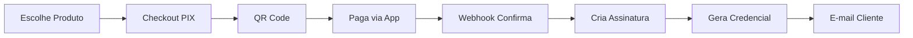

# Sistema E-commerce de Produtos Digitais

> Plataforma e-commerce com assinatura e entrega automatizada de credenciais.

## Stack Tecnológica

| Camada | Tecnologia |
|--------|------------|
| **Frontend** | Next.js 14, TypeScript, TailwindCSS, Radix UI |
| **Backend** | Fastify, Node.js 20, Prisma |
| **Database** | PostgreSQL 16 (Supabase) |
| **Cache/Queue** | Redis (Upstash, BullMQ) |
| **Payments** | Mercado Pago (PIX) |
| **Email** | Resend + React Email |
| **Storage** | Cloudflare R2 |
| **Deploy** | Vercel + Fly.io |

## Começando

### Pré-requisitos

- Node.js 20+
- pnpm 8+
- Docker + Docker Compose

### Instalação

```bash
# Clonar repositório
git clone <repo>
cd <repo>

# Instalar dependências
pnpm install

# Configurar ambiente
cp apps/api/.env.example apps/api/.env
cp apps/web/.env.example apps/web/.env

# Subir serviços (PostgreSQL + Redis)
docker-compose up -d

# Rodar migrations
pnpm --filter api db:migrate

# Seeder dados de desenvolvimento
pnpm --filter api db:seed

# Iniciar desenvolvimento
pnpm dev
```

### URLs

- Frontend: http://localhost:3000
- API: http://localhost:3001
- Prisma Studio: http://localhost:5555

## Estrutura

```
├── apps/
│   ├── web/                    # Frontend Next.js
│   │   └── src/
│   │       ├── app/          # App Router pages
│   │       ├── components/    # Componentes React
│   │       ├── lib/          # Utilitários
│   │       ├── hooks/        # Custom hooks
│   │       └── stores/        # Zustand stores
│   │
│   └── api/                    # Backend Fastify
│       └── src/
│           ├── modules/       # Feature modules
│           │   ├── auth/
│           │   ├── users/
│           │   ├── products/
│           │   ├── orders/
│           │   ├── payments/
│           │   ├── subscriptions/
│           │   ├── credentials/
│           │   └── webhooks/
│           ├── plugins/       # Fastify plugins
│           ├── services/      # Lógica de negócio
│           ├── jobs/         # BullMQ jobs
│           └── shared/       # Utilitários
│
├── packages/
│   ├── ui/                   # Componentes compartilhados
│   ├── tsconfig/            # Configurações TS
│   ├── eslint-config/       # ESLint
│   └── prettier-config/     # Prettier
│
├── docs/                     # Documentação
│   ├── FUNDACOES/           # Arquitetura, stack, ambiente
│   ├── DOMINIO/             # Modelo de dados, fluxos, contrato de API
│   ├── MODULOS/             # Documentação por módulo
│   ├── INFRAESTRUTURA/      # Deploy, monitoramento, segurança, integrações
│   ├── GUIAS/               # Como implementar
│   ├── REFERENCIAS/         # Design system e estudos de apoio
│   ├── CHECKLIST.md         # Checklist de implementação
│   └── ROADMAP.md           # Roadmap por fases
│
├── scripts/                  # Scripts auxiliares
│
├── DOCUMENTACAO...           # (removido — conteúdo em docs/)
└── ESTUDO-STACK...           # (removido — movido para docs/REFERENCIAS/)
```

## Documentação

- [Índice da documentação](docs/README.md) — ponto de partida
- [Arquitetura](docs/FUNDACOES/01-ARQUITETURA.md)
- [Design Reference](docs/REFERENCIAS/01-DESIGN-REFERENCE.md) — design system
- [Roadmap](docs/ROADMAP.md) e [Checklist](docs/CHECKLIST.md)
- [Estudo de Stack](docs/REFERENCIAS/ESTUDO-STACK.md) — racionalização das escolhas

## Módulos

| Módulo | Status | Descrição | Doc |
|--------|--------|-----------|-----|
| Autenticação | 🔴 Pendente | Login, registro, JWT | [README](docs/MODULOS/AUTENTICACAO/) |
| Usuários | 🔴 Pendente | Perfil, dados pessoais | [README](docs/MODULOS/USUARIOS/) |
| Produtos | 🔴 Pendente | Catálogo | [README](docs/MODULOS/PRODUTOS/) |
| Pagamentos | 🔴 Pendente | Checkout PIX, webhooks | [README](docs/MODULOS/PAGAMENTOS/) |
| Assinaturas | 🔴 Pendente | Gestão de assinaturas | [README](docs/MODULOS/ASSINATURAS/) |
| Credenciais | 🔴 Pendente | Entreia automática | [README](docs/MODULOS/CREDENCIAIS/) |
| Admin | 🔴 Pendente | Painel administrativo | [README](docs/MODULOS/ADMIN/) |

## Scripts

```bash
# Desenvolvimento
pnpm dev              # Iniciar todos os apps
pnpm build           # Build de produção
pnpm lint            # Verificar código
pnpm test            # Rodar testes

# Database
pnpm --filter api db:migrate     # Rodar migrations
pnpm --filter api db:seed        # Seed dados
pnpm --filter api db:studio      # Abrir Prisma Studio

# Gerar módulo
./scripts/generate-module.sh <nome>
```

## Fluxo Principal



## Contribuir

1. Leia a documentação a partir do [índice](docs/README.md)
2. Consulte o [Design Reference](docs/REFERENCIAS/01-DESIGN-REFERENCE.md) para tokens e componentes visuais
3. Implemente usando a estrutura em [docs/MODULOS/](docs/MODULOS/README.md)
4. Marque o progresso no [Checklist](docs/CHECKLIST.md)

## Licença

MIT
