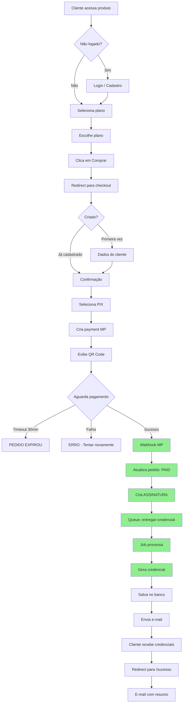

<!-- Origem: DOCUMENTACAO-SISTEMA-ECOMMERCE-DIGITAL.md, secao 14 -->

# Fluxos de Negócio

### 1. Fluxo de Compra Completo



### 2. Fluxo de Renovação

```mermaid
flowchart TD
    A[Cron: Todo dia 8h] --> B{Busca assinaturas}
    B --> C[dataProximaRenovacao = hoje}

    C --> D{Encontrou?}
    D -->|Não| E[Fim]
    D -->|Sim| F{Processar}

    F --> G[Cobrar PIX]
    G --> H{Sucesso?}

    H -->|Sim| I[Nova credencial]
    I --> J[E-mail confirmação]
    J --> K[Próximo ciclo]

    H -->|Não| L{Tentativas < 3}
    L -->|Sim| M[E-mail aviso]
    M --> N[Aguarda 2 dias]
    N --> G

    L -->|Não| O[SUSPENDER]
    O --> P[E-mail suspensão]
    P --> Q[Aguarda 7 dias]

    Q --> R{Quitou?}
    R -->|Sim| S[Reativar]
    S --> T[Credenciais reativadas]
    R -->|Não| U[CANCELAR]
    U --> V[Revoga credenciais]

    style I fill:#90EE90
    style S fill:#90EE90
    style U fill:#FFB6C1
```

---
