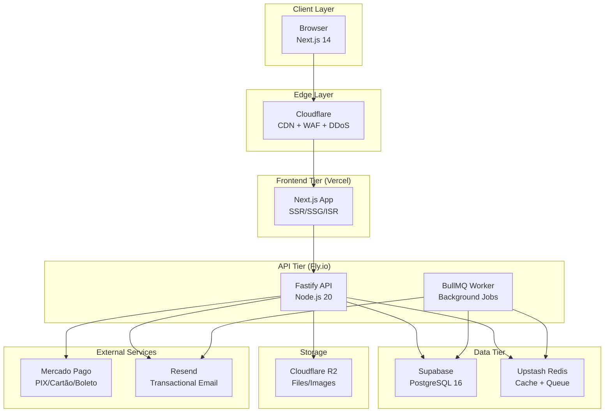
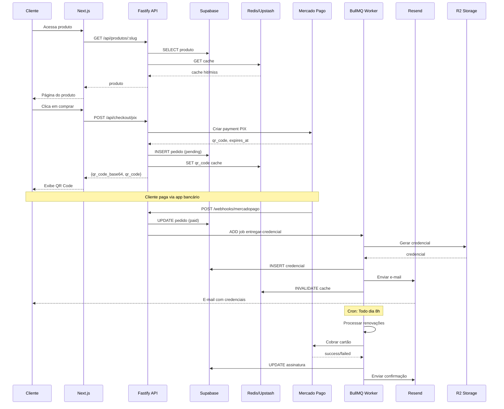

<!-- Origem: DOCUMENTACAO-SISTEMA-ECOMMERCE-DIGITAL.md, secoes 1 e 3 -->

# Visão Geral do Sistema

### 1. Conceito

Plataforma e-commerce focada em **produtos digitais com entrega automatizada de credenciais** e **gestão de assinaturas recorrentes**. O cliente adquire acesso a serviços (streaming, VPN, armazenamento em nuvem, etc.), recebe suas credenciais instantaneamente após a confirmação do pagamento, e a assinatura renova automaticamente.

### 2. Público-Alvo

| Segmento | Características |
|----------|------------------|
| **Consumidor Final** | Brasileiro, familiarizado com PIX, busca conveniência e imediata |
| **Produtos Digitais** | Streaming (vídeo/música), VPN, cloud storage, software as a service |
| **Modelos de Preço** | Mensal, trimestral, anual — preferência por mensal no Brasil |

### 3. Diferenciais Competitivos

- **Entrega Instantânea**: Credenciais disponibilizadas em até 30 segundos após confirmação de pagamento
- **Renovação Automática**: Sistema gerencia renovações sem intervenção do cliente
- **Gestão de Assinaturas**: Cliente pode gerenciar (visualizar, cancelar, reagendar) pela área logada
- **Suporte ao Cliente**: Sistema de tickets integrado para problemas com credenciais

---

# Arquitetura do Sistema

### 1. Diagrama de Arquitetura



### 2. Fluxo de Dados Principal



### 3. Arquitetura Monorepo

```
ecommerce-digital/
├── apps/
│   ├── web/                    # Next.js Frontend
│   │   ├── src/
│   │   │   ├── app/            # App Router pages
│   │   │   │   ├── (public)/   # Landing, produtos
│   │   │   │   ├── (auth)/     # Login, registro
│   │   │   │   ├── checkout/   # Checkout pages
│   │   │   │   ├── dashboard/  # Área do cliente
│   │   │   │   └── api/        # API routes (BFF)
│   │   │   ├── components/
│   │   │   │   ├── ui/        # Radix + Tailwind
│   │   │   │   ├── features/  # Domain components
│   │   │   │   └── layouts/   # Layouts
│   │   │   ├── lib/           # Utils, API client
│   │   │   ├── hooks/         # Custom hooks
│   │   │   └── stores/        # Zustand stores
│   │   ├── public/
│   │   └── package.json
│   │
│   └── api/                    # Fastify Backend
│       ├── src/
│       │   ├── modules/        # Feature modules
│       │   │   ├── auth/
│       │   │   ├── users/
│       │   │   ├── products/
│       │   │   ├── orders/
│       │   │   ├── subscriptions/
│       │   │   ├── credentials/
│       │   │   └── webhooks/
│       │   ├── plugins/       # Fastify plugins
│       │   ├── services/      # Business logic
│       │   ├── jobs/          # BullMQ jobs
│       │   ├── schemas/       # Zod schemas
│       │   └── shared/        # Utils, types
│       ├── prisma/
│       │   └── schema.prisma
│       ├── Dockerfile
│       └── package.json
│
├── packages/
│   ├── ui/                    # Shared UI components
│   ├── tsconfig/             # TypeScript configs
│   ├── eslint-config/        # ESLint configs
│   └── prettier-config/      # Prettier configs
│
├── turbo.json                # Turborepo config
├── package.json
└── README.md
```

---
