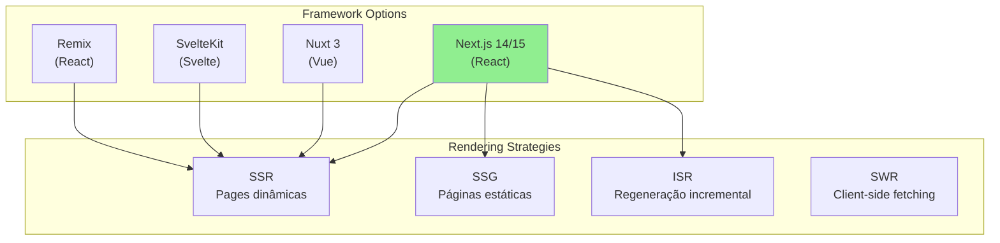
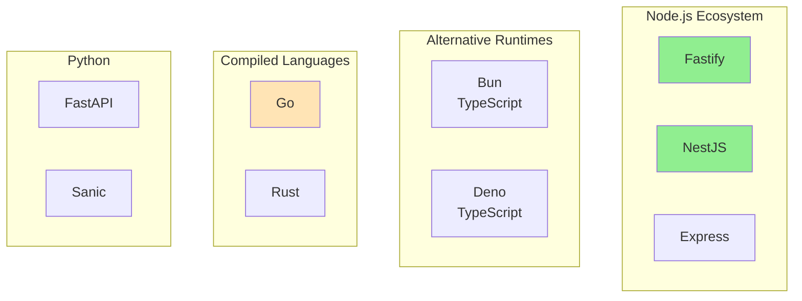
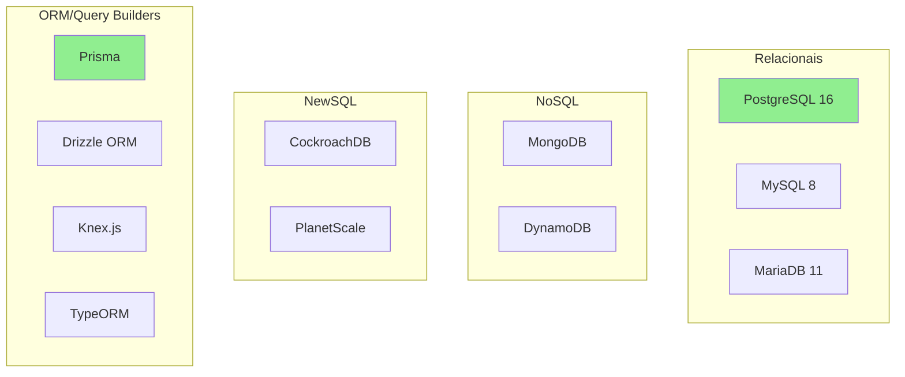
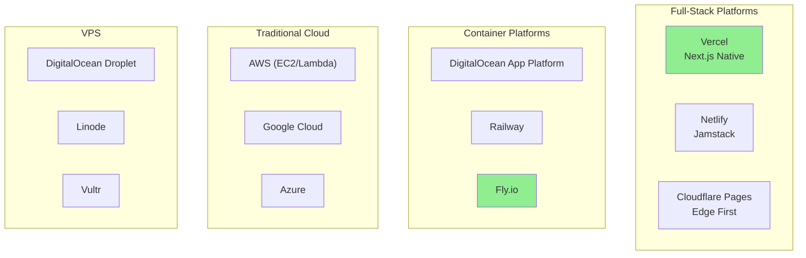

<!-- Origem: ESTUDO-STACK-TECNOLOGICA.md (movido da raiz do repositorio em 2026-10-20) -->

> **Este documento e material de estudo**, nao especificacao do sistema.
> Ele justifica *por que* cada tecnologia foi escolhida. Para a tabela de
> referencia rapida, veja [FUNDACOES/02-STACK-TEC.md](../FUNDACOES/02-STACK-TEC.md).
> A sintese visual completa esta na secao 14 deste arquivo (linha 2054).

# Estudo de Stack Tecnológica - E-commerce de Produtos Digitais

## Sumário

1. [Análise de Requisitos Técnicos](#1-análise-de-requisitos-técnicos)
2. [Frontend](#2-frontend)
3. [Backend/API](#3-backendapi)
4. [Banco de Dados](#4-banco-de-dados)
5. [Cache e Sessões](#5-cache-e-sessões)
6. [Filas e Jobs Assíncronos](#6-filas-e-jobs-assíncronos)
7. [Pagamentos](#7-pagamentos)
8. [Storage e CDN](#8-storage-e-cdn)
9. [Autenticação e Segurança](#9-autenticação-e-segurança)
10. [E-mail Transacional](#10-e-mail-transacional)
11. [Hospedagem e Infraestrutura](#11-hospedagem-e-infraestrutura)
12. [Monitoramento e Observabilidade](#12-monitoramento-e-observabilidade)
13. [Ferramentas de Desenvolvimento](#13-ferramentas-de-desenvolvimento)
14. [Stack Recomendada - Síntese Final](#14-stack-recomendada---síntese-final)
15. [Benchmarks e Referências](#15-benchmarks-e-referências)

---

## 1. Análise de Requisitos Técnicos

### 1.1 Requisitos do Domínio

```
┌─────────────────────────────────────────────────────────────────┐
│                    REQUISITOS FUNCIONAIS                        │
├─────────────────────────────────────────────────────────────────┤
│                                                                  │
│  E-Commerce B2C                                                  │
│  ├── Catálogo de produtos (leituras frequentes)                 │
│  ├── Carrinho e checkout                                        │
│  ├── Pagamentos (PIX, cartão, boleto)                          │
│  └── Confirmação instantânea                                    │
│                                                                  │
│  Assinaturas Recorrentes                                        │
│  ├── Renovação automática                                       │
│  ├── Cobrança no dia do vencimento                             │
│  ├── Tentativas de cobrança                                     │
│  └── Suspensão/Reativação                                       │
│                                                                  │
│  Entrega de Credenciais                                         │
│  ├── Geração automática pós-pagamento                          │
│  ├── Renovação de credenciais                                   │
│  └── Revogação em caso de cancelamento                          │
│                                                                  │
│  Área do Cliente                                                │
│  ├── Visualização de assinaturas                                │
│  ├── Visualização de credenciais (com mascaramento)            │
│  ├── Histórico de pagamentos                                    │
│  └── Suporte/Gestão da conta                                    │
│                                                                  │
│  Painel Administrativo                                           │
│  ├── CRUD de produtos                                           │
│  ├── Gestão de pedidos e assinaturas                            │
│  └── Relatórios e métricas                                      │
│                                                                  │
└─────────────────────────────────────────────────────────────────┘
```

### 1.2 Requisitos Não-Funcionais

| Categoria | Requisito | Impacto na Stack |
|----------|-----------|------------------|
| **Performance** | Tempo de resposta < 200ms | SSR/SSG, cache, CDN |
| **Escalabilidade** | 1000+ usuários simultâneos | Stateless API, autoscaling |
| **Disponibilidade** | 99.9% uptime | Multi-region, health checks |
| **Segurança** | LGPD, PCI-DSS (parcial) | Criptografia, HTTPS, tokens |
| **SEO** | Indexação Google | SSR, meta tags dinâmicas |
| **DX** | Time de 2-5 devs | Produtividade, curva de aprendizado |

### 1.3 Restrições do Projeto

- **Orçamento**: MVP com custo baixo, escalar gradualmente
- **Time**: 2-5 desenvolvedores full-stack
- **Prazo**: MVP em 8-12 semanas
- **Mercado**: Brasil (BRL, PIX, Mercado Pago)
- **Jurídico**: LGPD compliance

---

## 2. Frontend

### 2.1 Opções Analisadas



### 2.2 Comparativo Detalhado

| Aspecto | Next.js | Nuxt 3 | SvelteKit | Remix |
|---------|---------|--------|-----------|-------|
| **Linguagem** | TypeScript | TypeScript | TypeScript | TypeScript |
| **Curva de aprendizado** | Média | Média | Baixa | Média |
| **Ecossistema** | Excelente | Muito bom | Crescente | Bom |
| **Flexibilidade** | Alta | Alta | Alta | Média |
| **Performance** | ★★★★★ | ★★★★★ | ★★★★★ | ★★★★☆ |
| **SSR/SSG** | Ambos | Ambos | Ambos | SSR |
| **Vercel Integration** | Nativa | Boas | Razoável | Boa |
| **ISR** | Sim | Com plugin | Com plugin | Não |
| **App Router** | Sim (novo) |layouts aninhados) | Layouts | Routes |
| **Comunidade** | Massiva | Grande | Crescente | Média |
| **Jobs/Talentos** | Abundante | Bom | Limitado | Limitado |
| **Marketplace** | Vast | Bom | Limitado | Limitado |

### 2.3 Análise por Framework

#### Next.js 14/15 (Recomendado)

```
┌─────────────────────────────────────────────────────────────────┐
│                         NEXT.JS                                 │
├─────────────────────────────────────────────────────────────────┤
│                                                                  │
│  ✅ VANTAGENS                                                   │
│  ─────────────                                                  │
│  • Maior ecossistema React (componentes, libs)                 │
│  • Vercel para deploy gratuito (até certo limite)              │
│  • App Router com Server Components (reduz bundle JS)          │
│  • ISR para páginas de produto (estático + updates)            │
│  • API Routes integradas (BFF pattern)                         │
│  • TypeScript nativo                                            │
│  • Ótima DX e documentação                                      │
│  • Mercado de trabalho abundante                                │
│                                                                  │
│  ❌ DESVANTAGENS                                                │
│  ─────────────                                                  │
│  • Bundle size pode crescer (cuidado com imports)              │
│  •温水煮青蛙 - decisões de architecture podem ser complexas   │
│  • Lock-in com Vercel se usar features específicas             │
│                                                                  │
│  📊 CASOS DE USO PERFEITOS                                      │
│  ──────────────────────────                                     │
│  • E-commerce com SSR para SEO                                 │
│  • Landing pages com SSG                                        │
│  • Dashboards com Client Components                             │
│  • Páginas de produto com ISR                                   │
│                                                                  │
└─────────────────────────────────────────────────────────────────┘
```

#### Alternativas Menos Recomendadas

| Framework | Por que não (agora) |
|-----------|---------------------|
| **Nuxt 3** | Ótimo, mas ecossistema React é maior no Brasil |
| **SvelteKit** | Curva baixa, mas mercado de devs limitado |
| **Remix** | Excelente DX, mas menor comunidade que Next.js |
| **Astro** | Focado em conteúdo, menos flexível para app |

### 2.4 UI Libraries

| Library | Tamanho (gzip) | Customização | Acessibilidade | Popularidade |
|---------|----------------|--------------|----------------|--------------|
| **Radix UI + Tailwind** | ~15kb | Total | Excelente | Alta |
| **Shadcn/ui** | ~50kb (componentes) | Total | Excelente | Crescente |
| **MUI v5** | ~45kb | Boa | Boa | Massiva |
| **Chakra UI** | ~45kb | Boa | Boa | Grande |
| **Ant Design** | ~120kb | Limitada | Boa | Grande |
| **HeadlessUI** | ~10kb | Total | Excelente | Boa |

**Recomendação**: Radix UI (headless) + TailwindCSS + clsx

### 2.5 State Management

| Solução | Uso | Tamanho | Complexidade |
|---------|-----|---------|--------------|
| **Zustand** | Estado global simples | ~1kb | Baixa |
| **Jotai** | Estado atômico | ~2kb | Baixa |
| **Redux Toolkit** | Estado complexo | ~10kb | Média |
| **React Query** | Server state | ~13kb | Baixa |
| **SWR** | Server state | ~1kb | Baixa |
| **tRPC** | Type-safe API | ~5kb | Média |

**Recomendação**: Zustand (UI state) + React Query/SWR (server state)

### 2.6 Form Handling

| Library | Validação | Performance | DX |
|---------|-----------|-------------|-----|
| **React Hook Form** | Zod/Yup | Ótima (uncontrolled) | ★★★★★ |
| **Formik** | Yup/Zod | Boa | ★★★★☆ |
| **react-final-form** | Zod | Ótima | ★★★★☆ |

**Recomendação**: React Hook Form + Zod

---

## 3. Backend/API

### 3.1 Opções Analisadas



### 3.2 Comparativo Detalhado

| Aspecto | Fastify | NestJS | Express | Go | FastAPI |
|---------|---------|--------|---------|-----|---------|
| **Performance** | ★★★★★ | ★★★★☆ | ★★★☆☆ | ★★★★★ | ★★★★☆ |
| **TypeScript** | Nativo | Nativo | Parcial | Com reflect | Nativo |
| **Arquitetura** | Flexível | Opinionada | Mínima | Flexível | Flexível |
| **Escalabilidade** | Alta | Alta | Média | Muito alta | Alta |
| **Validação** | Schema/JSON | Class-validator | Manual | Go structs | Pydantic |
| **DI/IoC** | Plugin | Nativo | Manual | Manual | Manual |
| **Geração OpenAPI** | Plugin | Swagger | Manual | swaggo | Auto |
| **Testes** | Injecção direta | Jest | Manual | Testing lib | pytest |
| **Ecossistema** | Express compat | Angular-style | Massivo | Crescente | Python |
| **Curva aprendizado** | Baixa | Média-Alta | Baixa | Média | Baixa |
| **Mercado BR** | Crescente | Grande | Massivo | Crescente | Médio |

### 3.3 Análise Detalhada

#### Fastify + TypeScript (Recomendado)

```
┌─────────────────────────────────────────────────────────────────┐
│                         FASTIFY                                 │
├─────────────────────────────────────────────────────────────────┤
│                                                                  │
│  ✅ VANTAGENS                                                   │
│  ─────────────                                                  │
│  • Performance excepcional (até 50k req/s)                     │
│  • TypeScript nativo com types completos                        │
│  • Plugin system extensível                                     │
│  • Schema validation com JSON Schema (ultra-rápido)             │
│  • Logs estruturados (Pino)                                     │
│  • Compatível com Express middleware                            │
│  • Hot reload rápido (dev)                                      │
│  • Ecosystem maduro (auth, cors, rate-limit, etc)              │
│                                                                  │
│  ❌ DESVANTAGENS                                                │
│  ─────────────                                                  │
│  • Menos opinionado que NestJS (mais decisões do dev)          │
│  • DI manual ou via plugins                                     │
│  • Mercado um pouco menor que Express                           │
│                                                                  │
│  📊 BENCHMARKS (req/s com 50 concur.)                          │
│  ─────────────────────────────────────                          │
│  Fastify:     ~45,000                                           │
│  Express:     ~15,000                                           │
│  NestJS:      ~30,000 (com Fastify adapter)                    │
│  Go (Chi):    ~85,000                                           │
│  FastAPI:     ~35,000                                           │
│                                                                  │
└─────────────────────────────────────────────────────────────────┘
```

#### NestJS (Alternativa Sólida)

```
┌─────────────────────────────────────────────────────────────────┐
│                         NESTJS                                  │
├─────────────────────────────────────────────────────────────────┤
│                                                                  │
│  ✅ VANTAGENS                                                   │
│  ─────────────                                                  │
│  • Arquitetura opinionada (óbvia para todos)                   │
│  • DI nativo poderoso                                           │
│  • Modular (escalável)                                          │
│  • decorators TypeScript completos                              │
│  • Guard/Interceptor/Pipe pattern                               │
│  • Geração automática de Swagger/OpenAPI                        │
│  • Testes com Jest nativos                                      │
│  • Boa documentação                                             │
│                                                                  │
│  ❌ DESVANTAGENS                                                │
│  ─────────────                                                  │
│  • Curva de aprendizado íngreme                                │
│  • Overhead de decorators em decorators                         │
│  • Algumas vezes verboso                                        │
│  • Performance inferior a Fastify puro                          │
│  • "Angular-like" pode desmotivar React devs                    │
│                                                                  │
│  📊 QUANDO ESCOLHER                                             │
│  ──────────────────                                             │
│  • Times grandes (5+ devs) precisam de padrões consistentes    │
│  • Projetos de longa duração                                    │
│  • Quando todos já conhecem Angular                            │
│                                                                  │
└─────────────────────────────────────────────────────────────────┘
```

### 3.4 Runtime: Node.js vs Bun vs Deno

| Aspecto | Node.js 20 | Bun 1.0 | Deno 1.9 |
|---------|------------|---------|----------|
| **Performance** | Boa | Excelente | Boa |
| **Compatibilidade npm** | Total | 90%+ | Via compat |
| **TypeScript** | Config manual | Nativo | Nativo |
| **Stability** | Muito alta | Beta | Alta |
| **ECMAScript modules** | ✓ | ✓ | ✓ |
| **Workers** | ✓ | ✓ | ✓ |
| **Nativo HTTP** | ✓ | ✓ | ✓ |
| **Mercado** | Massivo | Emergente | Médio |
| **LTS** | Sim | Não | Não |

**Recomendação**: Node.js 20 LTS (estabilidade > performance por agora)

### 3.5 API Design Patterns

#### REST vs GraphQL vs tRPC

| Aspecto | REST | GraphQL | tRPC |
|---------|------|---------|------|
| **Type safety** | Com OpenAPI/Zod | Com codegen | Nativo |
| **Over-fetching** | Possível | Evitado | Evitado |
| **Under-fetching** | Possível | Evitado | Evitado |
| **Caching** | HTTP cache | Normalizado | Com QueryClient |
| **File uploads** | Multipart | Upload middleware | Multipart |
| **Learning curve** | Baixa | Média-Alta | Baixa |
| **Perf debugging** | Fácil | Difice | Fácil |
| **N+1 problem** | Comum | Possível | Possível |

**Recomendação para MVP**: REST com Zod validation

---

## 4. Banco de Dados

### 4.1 Opções Analisadas



### 4.2 Comparativo Detalhado

| Aspecto | PostgreSQL | MySQL | MongoDB | DynamoDB |
|---------|------------|-------|---------|----------|
| **Tipo** | Relacional | Relacional | Documento | Key-Value |
| **JSON** | Excelente (JSONB) | Moderado | Excelente | Map/Lists |
| **Transactions** | ACID total | ACID total | Multi-doc | Transações |
| **Full-text search** | Nativo | Nativo | Nativo | Com Elastic |
| **Geospatial** | PostGIS | Spatial | GeoJSON | Geo |
| **Performance** | ★★★★☆ | ★★★★☆ | ★★★★★ | ★★★★★ |
| **Escalabilidade** | Vertical + Citus | Vertical + Sharding | Sharding | Serverless |
| **ON DELETE** | FK + CASCADE | FK + CASCADE | Lookup | DDB |
| **Migrations** | Prisma/Drizzle | Prisma/Drizzle | Mongosh | CLI |
| **Ecossistema** | Excelente | Excelente | Bom | AWS-only |
| **Custo** | Baixo (self-hosted) | Baixo | Médio | Pay-per-use |

### 4.3 Análise Detalhada

#### PostgreSQL 16 (Recomendado)

```
┌─────────────────────────────────────────────────────────────────┐
│                      POSTGRESQL 16                              │
├─────────────────────────────────────────────────────────────────┤
│                                                                  │
│  ✅ VANTAGENS                                                   │
│  ─────────────                                                  │
│  • JSONB para dados semi-estruturados (credenciais, metadata)   │
│  • Full-text search nativo (não precisa de Elastic)            │
│  • window functions para relatórios                             │
│  • Partial indexes para performance                             │
│  • Row-level security (multitenancy se precisar)                │
│  • ARRAY column types                                           │
│  • BRIN indexes para logs (baixo storage)                       │
│  • pg_vector para future ML features                            │
│  • Excelente com dados relacionais (pedidos, assinaturas)       │
│                                                                  │
│  ❌ DESVANTAGENS                                                │
│  ─────────────                                                  │
│  • Sharding mais complexo que Mongo                             │
│  • Learning curve em features avançadas                        │
│                                                                  │
│  📊 EXTENSÕES ÚTEIS                                             │
│  ────────────────────                                           │
│  • pg_stat_statements - query performance                      │
│  • uuid-ossp - UUIDs                                           │
│  • citext - case-insensitive text                             │
│  • pg_trgm - fuzzy search                                     │
│  • pgcrypto - criptografia                                     │
│                                                                  │
└─────────────────────────────────────────────────────────────────┘
```

### 4.4 ORM vs Query Builder

| Aspecto | Prisma | Drizzle | Knex | TypeORM |
|---------|--------|---------|------|---------|
| **Type safety** | Total | Total | Parcial | Parcial |
| **Query API** | Fluent | SQL-like | Builder | Entity/Repo |
| **Migrations** | Declarativas | Declarativas | Migration files | CLI |
| **Performance** | Boa | Excelente | Excelente | Média |
| **Learning curve** | Baixa | Baixa | Média | Alta |
| **Raw SQL** | Sim | Sim | Sim | Sim |
| **Join fetches** | Include/select | Relations | Manual | Eager loading |
| **Pagination** | Built-in | Manual | Manual | Repository |
| **Status** | Ativo | Ativo | Maintenance | Controvérsio |

**Recomendação**: Prisma ORM (DX excelente, migrations declarativas)

### 4.5 Schema Design

```prisma
// schema.prisma

generator client {
  provider = "prisma-client-js"
}

datasource db {
  provider = "postgresql"
  url      = env("DATABASE_URL")
}

model Usuario {
  id              String       @id @default(uuid())
  email           String       @unique
  nome            String
  cpf             String?      @unique
  telefone        String?
  senhaHash       String
  emailVerificado  Boolean      @default(false)
  tokenVerificacao String?
  tokenResetSenha String?
  criadoEm        DateTime     @default(now())
  atualizadoEm    DateTime     @updatedAt
  ativo           Boolean      @default(true)
  
  // Relations
  pedidos         Pedido[]
  assinaturas     Assinatura[]
  credenciais     Credencial[]
 enderecos       Endereco[]

  @@index([email])
  @@index([cpf])
}

model Produto {
  id              String       @id @default(uuid())
  nome            String
  slug            String       @unique
  descricao       String?
  descricaoCurta  String?
  precoMensal     Decimal      @db.Decimal(10, 2)
  precoTrimestral Decimal?     @db.Decimal(10, 2)
  precoAnual      Decimal?     @db.Decimal(10, 2)
  imagemUrl       String?
  categoria       String?
  ativo           Boolean      @default(true)
  destaque        Boolean      @default(false)
  metadata        Json         @default("{}")
  criadoEm        DateTime     @default(now())
  atualizadoEm    DateTime     @updatedAt
  
  // Relations
  pedidos         Pedido[]
  assinaturas     Assinatura[]
  credenciais     Credencial[]
  
  @@index([slug])
  @@index([categoria])
  @@index([ativo])
}

model Pedido {
  id              String       @id @default(uuid())
  usuarioId       String
  produtoId       String
  assinaturaId    String?      @unique
  status          PedidoStatus @default(PENDING)
  tipoPagamento   TipoPagamento
  valor           Decimal      @db.Decimal(10, 2)
  mpPaymentId     String?      @unique
  mpPreferenceId  String?
  qrCodePix       String?
  qrCodeBase64    String?
  codigoPix       String?
  expiresAt       DateTime?
  pagoEm          DateTime?
  criadoEm        DateTime     @default(now())
  
  // Relations
  usuario         Usuario      @relation(fields: [usuarioId], references: [id])
  produto         Produto      @relation(fields: [produtoId], references: [id])
  assinatura      Assinatura?  @relation(fields: [assinaturaId], references: [id])
  fatura          Fatura?
  
  @@index([usuarioId])
  @@index([produtoId])
  @@index([status])
  @@index([mpPaymentId])
}

model Assinatura {
  id                  String           @id @default(uuid())
  usuarioId           String
  produtoId           String
  status              AssinaturaStatus @default(ACTIVE)
  plano               Plano
  dataInicio          DateTime
  dataFim             DateTime
  dataProximaRenovacao DateTime?
  mpPreapprovalId     String?          @unique
  mpSubscriptionId    String?          @unique
  tentativasRenovacao Int              @default(0)
  motivoCancelamento  String?
  canceladaEm         DateTime?
  criadoEm            DateTime         @default(now())
  atualizadoEm        DateTime         @updatedAt
  
  // Relations
  usuario             Usuario          @relation(fields: [usuarioId], references: [id])
  produto             Produto          @relation(fields: [produtoId], references: [id])
  pedido              Pedido?
  credenciais         Credencial[]
  faturas             Fatura[]
  
  @@index([usuarioId])
  @@index([produtoId])
  @@index([status])
  @@index([dataProximaRenovacao])
}

model Credencial {
  id              String    @id @default(uuid())
  usuarioId       String
  produtoId       String
  assinaturaId    String?
  tipo            String
  valores         Json      // Array de {nome, valor, isPassword}
  validade        DateTime?
  revogada        Boolean   @default(false)
  detalhes        Json      @default("{}")
  criadoEm        DateTime  @default(now())
  atualizadoEm    DateTime  @updatedAt
  
  // Relations
  usuario         Usuario    @relation(fields: [usuarioId], references: [id])
  produto         Produto    @relation(fields: [produtoId], references: [id])
  assinatura     Assinatura? @relation(fields: [assinaturaId], references: [id])
  
  @@index([usuarioId])
  @@index([assinaturaId])
  @@index([validade])
}

model Fatura {
  id              String       @id @default(uuid())
  assinaturaId    String
  pedidoId        String?      @unique
  status          FaturaStatus @default(PENDING)
  valor           Decimal      @db.Decimal(10, 2)
  tipoPagamento   TipoPagamento?
  mpPaymentId     String?      @unique
  dataVencimento  DateTime
  dataPagamento   DateTime?
  tentativas      Int          @default(0)
  ultimoErro      String?
  criadoEm        DateTime     @default(now())
  
  // Relations
  assinatura      Assinatura   @relation(fields: [assinaturaId], references: [id])
  pedido          Pedido?      @relation(fields: [pedidoId], references: [id])
  
  @@index([assinaturaId])
  @@index([status])
  @@index([dataVencimento])
}

// Enums
enum PedidoStatus {
  PENDING
  PAID
  FAILED
  REFUNDED
  CANCELLED
  EXPIRED
}

enum AssinaturaStatus {
  ACTIVE
  PAUSED
  CANCELLED
  EXPIRED
}

enum Plano {
  MONTHLY
  QUARTERLY
  YEARLY
}

enum TipoPagamento {
  PIX
  CARD
  BOLETO
}

enum FaturaStatus {
  PENDING
  PAID
  FAILED
  REFUNDED
  CANCELLED
}
```

---

## 5. Cache e Sessões

### 5.1 Opções Analisadas

| Solution | Tipo | Persistência | Performance | Casos de Uso |
|----------|------|--------------|-------------|--------------|
| **Redis** | In-Memory KV | Opicional | ★★★★★ | Cache, Sessions, Queue, Rate Limit |
| **Memcached** | In-Memory | Não | ★★★★★ | Cache simples |
| **Upstash** | Serverless Redis | Sim | ★★★★☆ | Edge, Serverless |
| **Vercel KV** | Serverless Redis | Sim | ★★★★☆ | Edge, Serverless |
| **Cloudflare KV** | Global KV | Sim | ★★★☆☆ | Config global |

### 5.2 Recomendação: Redis

```
┌─────────────────────────────────────────────────────────────────┐
│                          REDIS                                  │
├─────────────────────────────────────────────────────────────────┤
│                                                                  │
│  ✅ VANTAGENS                                                   │
│  ─────────────                                                  │
│  • Performance excepcional (~1M ops/s)                         │
│  • Múltiplos tipos de dados (String, Hash, Set, Sorted Set)    │
│  • Pub/Sub para real-time                                      │
│  • Transactions e Lua scripts                                   │
│  • Clustering para HA                                          │
│  • TTL nativo (ótimo para cache)                               │
│  • Modules (RediSearch, RedisJSON)                             │
│                                                                  │
│  📊 ESTRUTURAS PARA NOSSO PROJETO                              │
│  ────────────────────────────────                              │
│                                                                  │
│  Cache de produtos:                                            │
│  SET products:all "[{...}]" EX 3600                            │
│  HSET product:{slug} nome "VPN" preco 29.90                     │
│                                                                  │
│  Sessões:                                                      │
│  SET session:{userId}:{token} "{...}" EX 604800               │
│                                                                  │
│  Rate limiting:                                                │
│  INCR rate:{ip}:{endpoint}                                     │
│  EXPIRE rate:{ip}:{endpoint} 60                                │
│                                                                  │
│  Fila de jobs:                                                 │
│  LPUSH jobs:credencial "{jobData}"                            │
│  BRPOPLPUSH jobs:credencial jobs:processing 0                  │
│                                                                  │
└─────────────────────────────────────────────────────────────────┘
```

### 5.3 Estratégia de Cache

```
┌─────────────────────────────────────────────────────────────────┐
│                    CACHE STRATEGY                              │
├─────────────────────────────────────────────────────────────────┤
│                                                                  │
│  LAYER 1: CDN (Cloudflare)                                      │
│  ────────────────────────────                                   │
│  • Páginas públicas (estáticas)                                 │
│  • Imagens de produtos                                          │
│  • Assets (JS, CSS, fonts)                                       │
│  • TTL: 1 dia para assets, 1 hora para páginas                 │
│                                                                  │
│  LAYER 2: Application Cache (Redis)                            │
│  ─────────────────────────────────                              │
│  • Catálogo de produtos (30 min - 1 hora)                      │
│  • Dados de usuário (5 min)                                    │
│  • Sessões (7 dias)                                            │
│  • Rate limiting (1 min window)                                │
│                                                                  │
│  LAYER 3: Database Query Cache                                 │
│  ─────────────────────────────                                  │
│  • Queries frequentes                                           │
│  • Aggregações (dashboard admin)                               │
│  • Resultados de busca                                         │
│                                                                  │
│  CACHE INVALIDATION:                                           │
│  ────────────────────                                            │
│  • Write-through para dados críticos                           │
│  • TTL para dados voláteis                                     │
│  • Event-driven invalidation (pub/sub)                         │
│                                                                  │
└─────────────────────────────────────────────────────────────────┘
```

---

## 6. Filas e Jobs Assíncronos

### 6.1 Opções Analisadas

| Solution | Base | Reliability | Features | Custo |
|----------|------|-------------|----------|-------|
| **BullMQ** | Redis | Alta | ★★★★★ | Baixo (self-hosted) |
| **Sidekiq** | Redis | Alta | ★★★★★ | Baixo (self-hosted) |
| **Bee Queue** | Redis | Alta | ★★★★☆ | Baixo |
| **Bull** | Redis | Alta | ★★★★★ | Baixo |
| **AWS SQS** | AWS | Muito Alta | ★★★★☆ | Pay-per-use |
| **AWS Lambda** | AWS | Muito Alta | ★★★☆☆ | Pay-per-invoke |
| **Temporal** | PostgreSQL | Muito Alta | ★★★★★ | Alto |
| **Trigger.dev** | PostgreSQL | Alta | ★★★★☆ | Freemium |

### 6.2 Recomendação: BullMQ

```
┌─────────────────────────────────────────────────────────────────┐
│                         BULLMQ                                  │
├─────────────────────────────────────────────────────────────────┤
│                                                                  │
│  ✅ VANTAGENS                                                   │
│  ─────────────                                                  │
│  • Baseado em Redis (já usado para cache)                      │
│  • Excelente reliability (Redis persistence + job retries)     │
│  • Delayed jobs (renovações agendadas)                         │
│  • Prioritized queues                                           │
│  • Rate limiting por queue                                      │
│  • Concurrency control                                         │
│  • Job events (webhooks para monitoração)                      │
│  • sandboxed workers (isolate crashes)                        │
│  • UI dashboard (@bull-board)                                  │
│                                                                  │
│  ❌ DESVANTAGENS                                                │
│  ─────────────                                                  │
│  • Não é serverless-native                                     │
│  • Requer servidor rodando workers                             │
│                                                                  │
│  📊 JOBS PARA NOSSO PROJETO                                    │
│  ─────────────────────────                                      │
│                                                                  │
│  Queue: credentials                                            │
│  • gerar-credencial          (priority: high)                   │
│  • revogar-credencial        (priority: medium)                │
│                                                                  │
│  Queue: notifications                                          │
│  • enviar-email-boas-vindas   (priority: high)                  │
│  • enviar-email-renovacao     (priority: medium)                │
│  • enviar-email-lembrete      (priority: low)                   │
│                                                                  │
│  Queue: subscriptions                                          │
│  • processar-renovacao       (scheduled: cron)                 │
│  • verificar-vencimentos     (scheduled: cron)                  │
│  • suspender-assinatura      (scheduled: delayed)             │
│  • cancelar-assinatura        (scheduled: delayed)             │
│                                                                  │
│  Queue: webhooks                                              │
│  • processar-webhook-mp      (priority: high)                   │
│  • retry-webhook             (priority: medium)                 │
│                                                                  │
└─────────────────────────────────────────────────────────────────┘
```

### 6.3 Cron Jobs

```typescript
// src/jobs/scheduler.ts
import { Queue, Worker } from 'bullmq';
import { Container } from 'typedi';

export function setupScheduler() {
  const renewalQueue = Container.get('renewalQueue') as Queue;
  
  // A cada dia às 8h da manhã
  cron.schedule('0 8 * * *', async () => {
    const subscriptions = await findSubscriptionsDueToday();
    
    for (const subscription of subscriptions) {
      await renewalQueue.add('processar-renovacao', {
        assinaturaId: subscription.id,
        tentativa: 1,
      }, {
        priority: 1,
        attempts: 3,
        backoff: {
          type: 'exponential',
          delay: 60000, // 1 min
        },
      });
    }
  });
  
  // A cada 15 minutos: verificar expirados
  cron.schedule('*/15 * * * *', async () => {
    await verificarAssinaturasExpiradas();
  });
}
```

---

## 7. Pagamentos

### 7.1 Opções para Brasil

| Provider | PIX | Cartão | Boleto | Assinaturas | Taxas |
|----------|-----|--------|--------|-------------|-------|
| **Mercado Pago** | ✓ | ✓ | ✓ | ✓ | 3.99% + 2.99% |
| **Stone** | ✓ | ✓ | ✓ | ✓ | 2.99% + 2.99% |
| **PagSeguro** | ✓ | ✓ | ✓ | ✓ | 2.99% + 2.99% |
| **Stripe** | ✗ | ✓ | ✗ | ✓ | 3.49% + 0.40 |
| **Pagar.me** | ✓ | ✓ | ✓ | ✓ | 2.99% + 0.40 |

### 7.2 Recomendação: Mercado Pago

```
┌─────────────────────────────────────────────────────────────────┐
│                      MERCADO PAGO                               │
├─────────────────────────────────────────────────────────────────┤
│                                                                  │
│  ✅ VANTAGENS                                                   │
│  ─────────────                                                  │
│  • PIX nativo (preferência do brasileiro)                       │
│  • Checkout Pro (fluxo gerenciado)                             │
│  • Assinaturas (Pre-approvals)                                 │
│  • Webhooks confiáveis                                          │
│  • SDK Node.js oficial completo                                 │
│  • Sandbox para testes                                          │
│  • Parcelas configuráveis                                      │
│  • Split de pagamentos (se usar afiliados)                      │
│                                                                  │
│  📊 ENDPOINTS UTILIZADOS                                        │
│  ────────────────────                                           │
│                                                                  │
│  Payments                                                       │
│  POST /v1/payments              Criar pagamento               │
│  GET  /v1/payments/:id          Status do pagamento           │
│  POST /v1/payments/:id/refund   Estornar                       │
│                                                                  │
│  Preferences (Checkout Pro)                                     │
│  POST /checkout/preferences     Criar preference               │
│  GET  /checkout/preferences/:id Buscar preference              │
│                                                                  │
│  Pre-approvals (Assinaturas)                                   │
│  POST /preapprovals             Criar assinatura recorrente    │
│  GET  /preapprovals/:id         Status da assinatura           │
│  PUT  /preapprovals/:id         Atualizar assinatura          │
│  DELETE /preapprovals/:id       Cancelar                       │
│                                                                  │
│  Webhooks                                                       │
│  POST /v1/webhooks             Notificações IPN                 │
│                                                                  │
└─────────────────────────────────────────────────────────────────┘
```

### 7.3 Integração TypeScript

```typescript
// src/modules/payments/mercadopago.service.ts
import { MercadoPagoConfig, Payment, PreApproval, Customer } from 'mercadopago';

export class MercadoPagoService {
  private client: MercadoPagoConfig;
  private payment: Payment;
  private preApproval: PreApproval;
  
  constructor() {
    this.client = new MercadoPagoConfig({
      accessToken: process.env.MP_ACCESS_TOKEN!,
      options: {
        timeout: 10000,
      }
    });
    
    this.payment = new Payment(this.client);
    this.preApproval = new PreApproval(this.client);
  }
  
  // Criar preference PIX para checkout
  async criarPreferencePix(params: {
    descricao: string;
    valor: number;
    email: string;
    externalReference: string;
  }) {
    const response = await this.payment.create({
      body: {
        transaction_amount: params.valor,
        description: params.descricao,
        payment_method_id: 'pix',
        payer: {
          email: params.email,
        },
        external_reference: params.externalReference,
        notification_url: `${process.env.APP_URL}/api/webhooks/mercadopago`,
      }
    });
    
    return {
      paymentId: response.id,
      qrCode: response.point_of_interaction.transaction_data.qr_code,
      qrCodeBase64: response.point_of_interaction.transaction_data.qr_code_base64,
    };
  }
  
  // Verificar status de pagamento
  async buscarPagamento(paymentId: string) {
    return this.payment.get({ id: paymentId });
  }
  
  // Criar assinatura recorrente
  async criarPreApproval(params: {
    email: string;
    valor: number;
    descricao: string;
    frequencia: number; // meses
    diaDebito: number;
  }) {
    return this.preApproval.create({
      body: {
        payer_email: params.email,
        reason: params.descricao,
        external_reference: params.externalReference,
        auto_recurring: {
          frequency: params.frequencia,
          frequency_type: 'months',
          transaction_amount: params.valor,
          currency_id: 'BRL',
          debit_date: params.diaDebito,
        },
        back_url: `${process.env.FRONTEND_URL}/assinaturas`,
      }
    });
  }
}
```

### 7.4 Webhook Handler

```typescript
// src/modules/webhooks/mercadopago.controller.ts
import { Body, Post, Headers, Req } from 'routing-controllers';
import { MercadoPagoService } from '../payments/mercadopago.service';
import { PedidoService } from '../pedidos/pedido.service';
import { AssinaturaService } from '../assinaturas/assinatura.service';
import { Queue } from 'bullmq';

interface WebhookPayload {
  action: string;
  api_version: string;
  data: { id: string };
  id: number;
  type: string;
}

export class MercadoPagoWebhookController {
  
  constructor(
    private mpService: MercadoPagoService,
    private pedidoService: PedidoService,
    private assinaturaService: AssinaturaService,
    @Inject('webhookQueue') private webhookQueue: Queue,
  ) {}
  
  @Post('/webhooks/mercadopago')
  async handleWebhook(
    @Headers('x-signature') signature: string,
    @Body() payload: WebhookPayload,
  ) {
    // Verificar assinatura do webhook
    if (!this.validarAssinaturaWebhook(signature, payload)) {
      throw new UnauthorizedException('Assinatura inválida');
    }
    
    // Log para debug
    await this.logWebhook(payload);
    
    // Processar baseado no tipo de evento
    switch (payload.type) {
      case 'payment':
        await this.processarPagamento(payload.data.id);
        break;
        
      case 'preapproval':
        await this.processarAssinatura(payload.data.id);
        break;
        
      default:
        console.log(`Evento não tratado: ${payload.type}`);
    }
    
    return { status: 'ok' };
  }
  
  private async processarPagamento(paymentId: string) {
    const payment = await this.mpService.buscarPagamento(paymentId);
    
    if (payment.status === 'approved') {
      // Adicionar à fila para processamento assíncrono
      await this.webhookQueue.add('processar-pagamento-aprovado', {
        paymentId,
        externalReference: payment.external_reference,
      }, {
        priority: 1,
        attempts: 3,
        backoff: {
          type: 'exponential',
          delay: 5000,
        },
      });
    }
  }
}
```

---

## 8. Storage e CDN

### 8.1 Opções Analisadas

| Provider | Storage | CDN | Preço Brasil | Integração |
|----------|---------|-----|--------------|------------|
| **Cloudflare R2** | ✓ | Via CF | Free 10GB/mês | Excelente |
| **AWS S3** | ✓ | Via CloudFront | Pay-per-use | Excelente |
| **Vercel Blob** | ✓ | Via Vercel | Free 1GB | Nativa |
| **Supabase Storage** | ✓ | Não | Free 1GB | Boa |
| **Backblaze B2** | ✓ | Via CloudFlare | $0.006/GB | Boa |

### 8.2 Recomendação: Cloudflare R2 + Cloudflare CDN

```
┌─────────────────────────────────────────────────────────────────┐
│                    CLOUDFLARE R2 + CDN                         │
├─────────────────────────────────────────────────────────────────┤
│                                                                  │
│  ✅ VANTAGENS                                                   │
│  ─────────────                                                  │
│  • Sem custos de egress (diferencial!)                          │
│  • CDN global da Cloudflare (300+ PoPs)                        │
│  • Workers para processamento serverless                        │
│  • Images (otimização automática)                              │
│  • R2 + Workers = sem cold starts                             │
│  • Zero trust security                                         │
│                                                                  │
│  📊 USO NO PROJETO                                              │
│  ───────────────                                                │
│                                                                  │
│  • Imagens de produtos                                         │
│  • Avatares de usuários                                        │
│  • Arquivos de credenciais (PDFs, configs)                     │
│  • Logs e backups                                              │
│                                                                  │
│  💰 ESTIMATIVA DE CUSTO                                        │
│  ───────────────────────                                        │
│                                                                  │
│  Armazenamento: $0.015/GB/mês                                  │
│  100GB = $1.50/mês                                            │
│                                                                  │
│  Operações: $0.36/milhão PUT                                   │
│  $3.60/milhão GET                                             │
│                                                                  │
│  Comparação com S3:                                            │
│  S3 egress ~$0.09/GB → R2 = 100% economia em banda            │
│                                                                  │
└─────────────────────────────────────────────────────────────────┘
```

### 8.3 Upload Service

```typescript
// src/modules/storage/storage.service.ts
import { S3Client, PutObjectCommand, GetObjectCommand } from '@aws-sdk/client-s3';
import { getSignedUrl } from '@aws-sdk/s3-request-presigner';

export class StorageService {
  private r2: S3Client;
  private bucket = process.env.R2_BUCKET!;
  private publicUrl = process.env.R2_PUBLIC_URL!;
  
  constructor() {
    this.r2 = new S3Client({
      region: 'auto',
      endpoint: process.env.R2_ENDPOINT!,
      credentials: {
        accessKeyId: process.env.R2_ACCESS_KEY_ID!,
        secretAccessKey: process.env.R2_SECRET_ACCESS_KEY!,
      },
    });
  }
  
  async uploadFile(params: {
    key: string;
    body: Buffer;
    contentType: string;
    metadata?: Record<string, string>;
  }) {
    await this.r2.send(new PutObjectCommand({
      Bucket: this.bucket,
      Key: params.key,
      Body: params.body,
      ContentType: params.contentType,
      Metadata: params.metadata,
      // Cache-control para CDN
      CacheControl: 'public, max-age=31536000, immutable',
    }));
    
    return `${this.publicUrl}/${params.key}`;
  }
  
  async getSignedUploadUrl(key: string, contentType: string, expiresIn = 3600) {
    const command = new PutObjectCommand({
      Bucket: this.bucket,
      Key: key,
      ContentType: contentType,
    });
    
    return getSignedUrl(this.r2, command, { expiresIn });
  }
  
  async getSignedDownloadUrl(key: string, expiresIn = 3600) {
    const command = new GetObjectCommand({
      Bucket: this.bucket,
      Key: key,
    });
    
    return getSignedUrl(this.r2, command, { expiresIn });
  }
}
```

---

## 9. Autenticação e Segurança

### 9.1 Opções Analisadas

| Solution | Provider | MFA | OAuth | Custo |
|----------|----------|-----|-------|-------|
| **NextAuth.js** | Self-hosted | ✓ | ✓ | Free |
| **Auth.js** | Self-hosted | ✓ | ✓ | Free |
| **Clerk** | SaaS | ✓ | ✓ | Free tier + pay |
| **Supabase Auth** | Self-hosted | ✓ | ✓ | Free tier |
| **Firebase Auth** | SaaS | ✓ | ✓ | Free tier |
| **AWS Cognito** | AWS | ✓ | ✓ | Pay-per-user |

### 9.2 Recomendação: NextAuth.js v5

```
┌─────────────────────────────────────────────────────────────────┐
│                      NEXTAUTH.JS v5                             │
├─────────────────────────────────────────────────────────────────┤
│                                                                  │
│  ✅ VANTAGENS                                                   │
│  ─────────────                                                  │
│  • TypeScript nativo                                            │
│  • Integração nativa com Next.js                               │
│  • JWT ou Database sessions                                     │
│  • Múltiplos provedores OAuth                                   │
│  • Middleware para proteção de rotas                            │
│  • Sem lock-in                                                  │
│  • Total controle do código                                     │
│  • Composable (email magic links, etc)                         │
│                                                                  │
│  ❌ DESVANTAGENS                                                │
│  ─────────────                                                  │
│  • Implementação manual de algumas features                     │
│  • Dashboard admin não incluso                                 │
│                                                                  │
│  📊 ESTRATÉGIA DE SESSÃO                                        │
│  ─────────────────────                                          │
│                                                                  │
│  JWT Strategy (para performance):                               │
│  • Access token: 15 min (em memória)                          │
│  • Refresh token: 7 dias (em HTTP-only cookie)                 │
│                                                                  │
│  Database Sessions (alternativa para mais controle):           │
│  • Sessões na tabela usuarios                                  │
│  • Blacklist de tokens                                         │
│  • Permite revogação instantânea                               │
│                                                                  │
└─────────────────────────────────────────────────────────────────┘
```

### 9.3 Implementação

```typescript
// src/lib/auth.ts
import NextAuth from 'next-auth';
import { PrismaAdapter } from '@auth/prisma-adapter';
import Credentials from 'next-auth/providers/credentials';
import Google from 'next-auth/providers/google';
import bcrypt from 'bcryptjs';
import { prisma } from '@/lib/prisma';

export const { handlers, signIn, signOut, auth } = NextAuth({
  adapter: PrismaAdapter(prisma),
  session: {
    strategy: 'jwt',
    maxAge: 30 * 24 * 60 * 60, // 30 dias
  },
  pages: {
    signIn: '/login',
    error: '/login',
  },
  providers: [
    Google({
      clientId: process.env.GOOGLE_CLIENT_ID!,
      clientSecret: process.env.GOOGLE_CLIENT_SECRET!,
    }),
    Credentials({
      name: 'credentials',
      credentials: {
        email: { label: 'Email', type: 'email' },
        password: { label: 'Password', type: 'password' },
      },
      async authorize(credentials) {
        if (!credentials?.email || !credentials?.password) {
          return null;
        }
        
        const user = await prisma.usuario.findUnique({
          where: { email: credentials.email as string },
        });
        
        if (!user || !user.senhaHash) {
          return null;
        }
        
        const isValid = await bcrypt.compare(
          credentials.password as string,
          user.senhaHash
        );
        
        if (!isValid) {
          return null;
        }
        
        return {
          id: user.id,
          email: user.email,
          nome: user.nome,
        };
      },
    }),
  ],
  callbacks: {
    async jwt({ token, user, trigger, session }) {
      if (user) {
        token.id = user.id;
      }
      
      // Forçar update do token quando session é atualizada
      if (trigger === 'update' && session?.nome) {
        token.nome = session.nome;
      }
      
      return token;
    },
    async session({ session, token }) {
      if (session.user) {
        session.user.id = token.id as string;
      }
      return session;
    },
  },
});

// Middleware para proteger rotas
export const withAuth = () => {
  // Implementação via middleware.ts
};
```

### 9.4 Middleware de Proteção

```typescript
// middleware.ts
import { auth } from '@/lib/auth';
import { NextResponse } from 'next/server';

export default auth((req) => {
  const isLoggedIn = !!req.auth;
  const isOnProtectedRoute = 
    req.nextUrl.pathname.startsWith('/dashboard') ||
    req.nextUrl.pathname.startsWith('/assinaturas') ||
    req.nextUrl.pathname.startsWith('/credenciais') ||
    req.nextUrl.pathname.startsWith('/admin');
  
  const isOnAuthRoute = 
    req.nextUrl.pathname.startsWith('/login') ||
    req.nextUrl.pathname.startsWith('/register');
  
  if (isOnProtectedRoute && !isLoggedIn) {
    return NextResponse.redirect(new URL('/login', req.nextUrl));
  }
  
  if (isOnAuthRoute && isLoggedIn) {
    return NextResponse.redirect(new URL('/dashboard', req.nextUrl));
  }
  
  return NextResponse.next();
});

export const config = {
  matcher: ['/((?!api|_next/static|_next/image|favicon.ico).*)'],
};
```

### 9.5 Segurança Adicional

```typescript
// src/middleware/security.ts
import helmet from 'helmet';

export const securityHeaders = helmet({
  contentSecurityPolicy: {
    directives: {
      defaultSrc: ["'self'"],
      scriptSrc: ["'self'", "'unsafe-inline'", "https://js.stripe.com"],
      frameSrc: ["'self'", "https://js.stripe.com"],
      styleSrc: ["'self'", "'unsafe-inline'", "https://fonts.googleapis.com"],
      fontSrc: ["'self'", "https://fonts.gstatic.com"],
      imgSrc: ["'self'", "data:", "https:"],
      connectSrc: ["'self'", "https://api.stripe.com", "https://api.mercadopago.com"],
    },
  },
  hsts: {
    maxAge: 31536000,
    includeSubDomains: true,
    preload: true,
  },
  frameguard: {
    action: 'deny',
  },
  noSniff: true,
  xssFilter: true,
});

// Rate limiting
import { Ratelimit } from '@upstash/ratelimit';
import { Redis } from '@upstash/redis';

const ratelimit = new Ratelimit({
  redis: Redis.fromEnv(),
  limiter: Ratelimit.slidingWindow(100, '1 m'),
  analytics: true,
});

export async function rateLimit(identifier: string) {
  const { success, remaining, reset } = await ratelimit.limit(identifier);
  
  if (!success) {
    throw new TooManyRequestsError(`Rate limit exceeded. Reset at ${reset}`);
  }
  
  return { remaining };
}
```

---

## 10. E-mail Transacional

### 10.1 Opções Analisadas

| Provider | Preço | Templates | Analytics | Brasil |
|----------|-------|-----------|-----------|--------|
| **Resend** | Free 3k/mês | React Email | Básico | ✓ |
| **SendGrid** | Free 100/mês | Editor | Avançado | ✓ |
| **Mailgun** | Free 5k/mês | API | Básico | ✓ |
| **Postmark** | $15/mês | Templates | Avançado | ✗ |
| **Amazon SES** | Pay-per-email | API | ✗ | ✓ |
| **Brevo (Sendinblue)** | Free 300/mês | Editor | Bom | ✓ |

### 10.2 Recomendação: Resend

```
┌─────────────────────────────────────────────────────────────────┐
│                          RESEND                                 │
├─────────────────────────────────────────────────────────────────┤
│                                                                  │
│  ✅ VANTAGENS                                                   │
│  ─────────────                                                  │
│  • React Email (templates em React)                            │
│  • TypeScript-first                                             │
│  • Excelente deliverability                                     │
│  • Warm-up assistido                                            │
│  • Webhooks para analytics                                      │
│  • API simples e direta                                         │
│  • Rate limits generosos                                        │
│  • $0 no tier gratuito (3k emails)                            │
│                                                                  │
│  📊 E-MAILS DO PROJETO                                          │
│  ────────────────────                                           │
│                                                                  │
│  • Boas-vindas                                                  │
│  • Confirmação de e-mail                                        │
│  • Confirmação de pagamento                                     │
│  • Credenciais (acesso)                                         │
│  • Renovação pendente                                           │
│  • Renovação confirmada                                         │
│  • Lembrete de vencimento                                       │
│  • Suspensão de conta                                           │
│  • Cancelamento confirmado                                      │
│  • Reset de senha                                               │
│                                                                  │
└─────────────────────────────────────────────────────────────────┘
```

### 10.3 Template Example

```typescript
// src/email/templates/credenciais.tsx
import { Html, Head, Body, Container, Section, Text, Button, Hr, Img } from '@react-email/components';
import { format } from 'date-fns';
import { ptBR } from 'date-fns/locale';

interface CredenciaisEmailProps {
  nome: string;
  produto: string;
  credenciais: {
    nome: string;
    valor: string;
    isPassword: boolean;
  }[];
  validade: Date;
}

export function CredenciaisEmail({
  nome,
  produto,
  credenciais,
  validade,
}: CredenciaisEmailProps) {
  return (
    <Html lang="pt-BR">
      <Head>
        <title>Suas Credenciais - {produto}</title>
      </Head>
      <Body style={styles.body}>
        <Container style={styles.container}>
          <Section style={styles.header}>
            
          </Section>
          
          <Section style={styles.content}>
            <Text style={styles.greeting}>Olá, {nome}!</Text>
            <Text style={styles.text}>
              Seu acesso ao <strong>{produto}</strong> foi confirmado! 
              Abaixo estão suas credenciais de acesso:
            </Text>
            
            <Section style={styles.credentialsBox}>
              {credenciais.map((cred, index) => (
                <div key={index} style={styles.credentialRow}>
                  <Text style={styles.credentialLabel}>{cred.nome}</Text>
                  <Text style={cred.isPassword ? styles.credentialPassword : styles.credentialValue}>
                    {cred.isPassword ? '••••••••••••' : cred.valor}
                  </Text>
                </div>
              ))}
            </Section>
            
            <Text style={styles.text}>
              Sua assinatura está ativa até <strong>{format(validade, "dd 'de' MMMM 'de' yyyy", { locale: ptBR })}</strong>.
            </Text>
            
            <Button href={`${process.env.FRONTEND_URL}/credenciais`} style={styles.button}>
              Ver Minhas Credenciais
            </Button>
          </Section>
          
          <Hr style={styles.hr} />
          
          <Section style={styles.footer}>
            <Text style={styles.footerText}>
              Se você não reconhece esta compra, entre em contato com nosso suporte imediatamente.
            </Text>
            <Text style={styles.footerText}>
              © 2024 {process.env.COMPANY_NAME}. Todos os direitos reservados.
            </Text>
          </Section>
        </Container>
      </Body>
    </Html>
  );
}

const styles = {
  body: { backgroundColor: '#f6f9fc', fontFamily: 'sans-serif' },
  container: { backgroundColor: '#ffffff', margin: '0 auto', padding: '20px', maxWidth: '600px', borderRadius: '8px' },
  header: { textAlign: 'center' as const, marginBottom: '30px' },
  content: { padding: '0 20px' },
  greeting: { fontSize: '24px', fontWeight: 'bold', marginBottom: '20px' },
  text: { fontSize: '16px', lineHeight: '24px', color: '#525f7f' },
  credentialsBox: { backgroundColor: '#f8fafc', padding: '20px', borderRadius: '8px', marginBottom: '20px' },
  credentialRow: { marginBottom: '15px' },
  credentialLabel: { fontSize: '12px', color: '#8898aa', textTransform: 'uppercase' as const },
  credentialValue: { fontSize: '16px', fontFamily: 'monospace' },
  credentialPassword: { fontSize: '16px', fontFamily: 'monospace', letterSpacing: '2px' },
  button: { backgroundColor: '#656ee8', color: '#ffffff', padding: '12px 24px', borderRadius: '6px', textDecoration: 'none', display: 'inline-block' },
  hr: { borderColor: '#e6ebf1', margin: '20px 0' },
  footer: { padding: '0 20px' },
  footerText: { fontSize: '12px', color: '#8898aa', textAlign: 'center' as const },
};
```

### 10.4 Email Service

```typescript
// src/modules/email/email.service.ts
import { Resend } from 'resend';
import { ReactRenderer } from '@react-email/render';
import { CredenciaisEmail } from '../email/templates/credenciais';

export class EmailService {
  private resend: Resend;
  
  constructor() {
    this.resend = new Resend(process.env.RESEND_API_KEY);
  }
  
  async enviarCredenciais(params: CredenciaisEmailProps) {
    const html = new ReactRenderer().toHtml(
      <CredenciaisEmail {...params} />
    );
    
    await this.resend.emails.send({
      from: 'Minha Loja <noreply@minhaloja.com.br>',
      to: params.email,
      subject: `Suas credenciais de acesso - ${params.produto}`,
      html,
    });
  }
  
  async enviarPagamentoConfirmado(params: PagamentoConfirmadoProps) {
    const html = new ReactRenderer().toHtml(
      <PagamentoConfirmadoEmail {...params} />
    );
    
    await this.resend.emails.send({
      from: 'Minha Loja <noreply@minhaloja.com.br>',
      to: params.email,
      subject: 'Pagamento confirmado!',
      html,
    });
  }
  
  async enviarLembreteRenovacao(params: LembreteRenovacaoProps) {
    const html = new ReactRenderer().toHtml(
      <LembreteRenovacaoEmail {...params} />
    );
    
    await this.resend.emails.send({
      from: 'Minha Loja <noreply@minhaloja.com.br>',
      to: params.email,
      subject: 'Sua assinaturaRenova em breve',
      html,
    });
  }
}
```

---

## 11. Hospedagem e Infraestrutura

### 11.1 Opções de Deploy



### 11.2 Comparativo Detalhado

| Provider | Free Tier | Auto-scale | Edge | DB Included | Brasil Latency |
|----------|-----------|------------|------|-------------|----------------|
| **Vercel** | 100GB bandwidth | ✓ | ✓ | ✗ | ~50ms |
| **Railway** | $5 crédito | ✓ | ✗ | ✓ | ~80ms |
| **Fly.io** | 3 VMs free | ✓ | ✗ | ✗ | ~60ms |
| **DigitalOcean** | ✗ | Config manual | ✗ | ✓ | ~10ms |
| **AWS** | ✗ | ✓ | ✓ | ✓ | ~30ms |
| **Cloudflare** | Unlimited | ✓ | ✓ | ✗ | ~50ms |

### 11.3 Recomendação: Hybrid Approach

```
┌─────────────────────────────────────────────────────────────────┐
│                 STACK DE DEPLOY RECOMENDADA                     │
├─────────────────────────────────────────────────────────────────┤
│                                                                  │
│  FRONTEND                                                       │
│  ━━━━━━━━━━━━━━━━━━━━━━━━━━━━━━━━━━━━━━━━━━━━━━━━━━━━━━━━━━   │
│  Platform: Vercel                                               │
│  • Deploy automático via GitHub                                │
│  • Preview deployments para PRs                                 │
│  • Edge functions para middleware                              │
│  • ISR para páginas de produto                                 │
│  • CDN global                                                  │
│  Custo: Free (até 100GB bandwidth/mês)                        │
│                                                                  │
│  BACKEND/API                                                    │
│  ━━━━━━━━━━━━━━━━━━━━━━━━━━━━━━━━━━━━━━━━━━━━━━━━━━━━━━━━━━   │
│  Platform: Fly.io (Docker containers)                          │
│  • Multi-region deployment                                     │
│  • Autoscaling baseado em CPU/mem                              │
│  • Postgres gerenciado incluso                                 │
│  • Deploy via Dockerfile                                       │
│  Custo: Free tier (3 VMs, 160MB RAM cada)                    │
│                                                                  │
│  DATABASE                                                       │
│  ━━━━━━━━━━━━━━━━━━━━━━━━━━━━━━━━━━━━━━━━━━━━━━━━━━━━━━━━━━   │
│  Primary: Supabase (PostgreSQL gerenciado)                     │
│  • Free tier: 500MB storage, 2GB transfer                     │
│  • Daily backups                                               │
│  • Real-time subscriptions (para futuro)                       │
│  • Auto-scaling opcional                                       │
│  Custo: Free → $25/mês (pro)                                   │
│                                                                  │
│  REDIS/CACHE                                                    │
│  ━━━━━━━━━━━━━━━━━━━━━━━━━━━━━━━━━━━━━━━━━━━━━━━━━━━━━━━━━━   │
│  Platform: Upstash (Serverless Redis)                          │
│  • Free tier: 10k commands/day                                 │
│  • Global replication                                          │
│  • REST API (sem connection limits)                            │
│  Custo: Free → $10/mês (pay-as-you-grow)                      │
│                                                                  │
│  STORAGE                                                        │
│  ━━━━━━━━━━━━━━━━━━━━━━━━━━━━━━━━━━━━━━━━━━━━━━━━━━━━━━━━━━   │
│  Platform: Cloudflare R2                                        │
│  • 10GB storage free                                           │
│  • Zero egress cost                                            │
│  • CDN via Cloudflare                                           │
│  Custo: $0 (free tier) → $0.015/GB                            │
│                                                                  │
│  MONITORING                                                     │
│  ━━━━━━━━━━━━━━━━━━━━━━━━━━━━━━━━━━━━━━━━━━━━━━━━━━━━━━━━━━   │
│  • Sentry: Error tracking (Free tier: 5k events/mês)          │
│  • Plausible: Analytics (Free tier: 10k pageviews/mês)        │
│  • Grafana Cloud: Metrics (Free tier: 10k series)            │
│                                                                  │
└─────────────────────────────────────────────────────────────────┘
```

### 11.4 Arquitetura de Deploy

```
┌─────────────────────────────────────────────────────────────────┐
│                    ARQUITETURA DE DEPLOY                       │
├─────────────────────────────────────────────────────────────────┤
│                                                                  │
│  ┌─────────────────────────────────────────────────────────┐    │
│  │                    CLOUDFLARE                          │    │
│  │  ┌──────────────┐  ┌──────────────┐  ┌──────────────┐  │    │
│  │  │ CDN/WAF     │  │ Edge Workers │  │ R2 Storage   │  │    │
│  │  │ 300+ PoPs   │  │ Auth, A/B    │  │ Images       │  │    │
│  │  └──────────────┘  └──────────────┘  └──────────────┘  │    │
│  └─────────────────────────────────────────────────────────┘    │
│                              │                                   │
│                              ▼                                   │
│  ┌─────────────────────────────────────────────────────────┐    │
│  │                      VERCEL                             │    │
│  │  ┌──────────────────────────────────────────────────┐  │    │
│  │  │  Frontend (Next.js)                              │  │    │
│  │  │  • Landing pages (SSG)                         │  │    │
│  │  │  • Checkout pages (SSR)                        │  │    │
│  │  │  • Dashboard (Client)                          │  │    │
│  │  └──────────────────────────────────────────────────┘  │    │
│  └─────────────────────────────────────────────────────────┘    │
│                              │                                   │
│                              ▼                                   │
│  ┌─────────────────────────────────────────────────────────┐    │
│  │                       FLY.IO                            │    │
│  │  ┌──────────────┐  ┌──────────────┐  ┌──────────────┐  │    │
│  │  │ API Server  │  │ Worker       │  │ Cron Jobs    │  │    │
│  │  │ (Node.js)   │  │ (BullMQ)     │  │ (node-cron)  │  │    │
│  │  │ Port 3000   │  │ Background   │  │ Scheduler    │  │    │
│  │  └──────────────┘  └──────────────┘  └──────────────┘  │    │
│  └─────────────────────────────────────────────────────────┘    │
│                              │                                   │
│              ┌───────────────┼───────────────┐                  │
│              ▼               ▼               ▼                  │
│  ┌──────────────┐  ┌──────────────┐  ┌──────────────┐           │
│  │   SUPABASE  │  │   UPSTASH    │  │   RESEND     │           │
│  │  PostgreSQL │  │    Redis     │  │   E-mail     │           │
│  │  Auth       │  │   Cache      │  │              │           │
│  │  Storage    │  │   Queue      │  │              │           │
│  └──────────────┘  └──────────────┘  └──────────────┘           │
│                                                                  │
└─────────────────────────────────────────────────────────────────┘
```

---

## 12. Monitoramento e Observabilidade

### 12.1 Stack de Observabilidade

```
┌─────────────────────────────────────────────────────────────────┐
│                    OBSERVABILITY STACK                          │
├─────────────────────────────────────────────────────────────────┤
│                                                                  │
│  TRACES (Tracing Distribuído)                                   │
│  ──────────────────────────────                                  │
│  • OpenTelemetry (vendor-neutral)                              │
│  • Tempo (Grafana) para storage                                 │
│  • Export via OTLP                                              │
│  • Traces: API → DB → External APIs                           │
│                                                                  │
│  METRICS (Métricas)                                             │
│  ─────────────────────────                                       │
│  • Prometheus (collection)                                     │
│  • Grafana (visualization)                                      │
│  • Custom metrics: request count, latency, error rate            │
│  • Infrastructure: CPU, memory, disk, network                   │
│                                                                  │
│  LOGS (Logs Estruturados)                                       │
│  ──────────────────────────                                      │
│  • Pino (structured logging in Node)                           │
│  • Grafana Loki (storage, cost-effective)                      │
│  • Correlação com traces via trace_id                          │
│                                                                  │
│  ERRORS (Error Tracking)                                        │
│  ──────────────────────                                         │
│  • Sentry (JS/Node)                                           │
│  • Source maps uploadados                                      │
│  • Source context preserved                                    │
│  • Alerts via Slack/Discord                                    │
│                                                                  │
└─────────────────────────────────────────────────────────────────┘
```

### 12.2 Métricas de Negócio

```typescript
// src/monitoring/metrics.ts
import { Counter, Histogram, Gauge } from 'prom-client';
import { Registry, collectDefaultMetrics } from 'prom-client';

// Create a Registry
const register = new Registry();

// Collect default metrics
collectDefaultMetrics({ register });

// Custom metrics
export const pedidosCriados = new Counter({
  name: 'pedidos_criados_total',
  help: 'Total de pedidos criados',
  labelNames: ['tipo_pagamento', 'produto'],
  registers: [register],
});

export const pedidosPagos = new Counter({
  name: 'pedidos_pagos_total',
  help: 'Total de pedidos pagos',
  labelNames: ['tipo_pagamento', 'produto'],
  registers: [register],
});

export const tempoCheckout = new Histogram({
  name: 'checkout_duracao_segundos',
  help: 'Tempo de checkout em segundos',
  buckets: [5, 10, 30, 60, 120, 300],
  registers: [register],
});

export const assinaturasAtivas = new Gauge({
  name: 'assinaturas_ativas',
  help: 'Número de assinaturas ativas',
  labelNames: ['produto', 'plano'],
  registers: [register],
});

export const credenciaisEntregues = new Histogram({
  name: 'credencial_entrega_duracao_ms',
  help: 'Tempo para entrega de credencial em ms',
  buckets: [100, 500, 1000, 2000, 5000],
  registers: [register],
});

// Express route handler
import { Request, Response } from 'express';

app.get('/metrics', async (req: Request, res: Response) => {
  res.set('Content-Type', register.contentType);
  res.send(await register.metrics());
});
```

### 12.3 Alertas

```yaml
# grafana/alerts.yml
apiVersion: 1
groups:
  - name: ecommerce-critical
    interval: 1m
    rules:
      - alert: HighErrorRate
        expr: rate(http_requests_total{status=~"5.."}[5m]) > 0.05
        for: 5m
        labels:
          severity: critical
          team: backend
        annotations:
          summary: "Taxa de erro HTTP 5xx acima de 5%"
          description: "Mais de 5% das requisições estão retornando erro."
          runbook_url: "https://wiki/runbooks/high-error-rate"
        
      - alert: PaymentFailureSpike
        expr: |
          rate(renovacoes_total{status="failed"}[1h]) 
          / rate(renovacoes_total[1h]) > 0.3
        for: 10m
        labels:
          severity: warning
          team: payments
        annotations:
          summary: "Pico de falhas em renovação"
          description: "Mais de 30% das tentativas de renovação estão falhando."
          
      - alert: SlowCredentialDelivery
        expr: histogram_quantile(0.95, credencial_entrega_duracao_ms) > 5000
        for: 5m
        labels:
          severity: warning
          team: infrastructure
        annotations:
          summary: "Entrega de credenciais lenta"
          description: "P95 de entrega está acima de 5 segundos."
          
      - alert: DatabaseConnectionsHigh
        expr: pg_stat_database_numbackends / pg_settings_max_connections > 0.8
        for: 5m
        labels:
          severity: warning
        annotations:
          summary: "Conexões de banco elevadas"
          
      - alert: QueueBacklogGrowing
        expr: increase(bullmq_jobs_active[15m]) > 100
        for: 10m
        labels:
          severity: warning
        annotations:
          summary: "Fila de jobs crescendo"
```

---

## 13. Ferramentas de Desenvolvimento

### 13.1 Core Stack

```json
// package.json
{
  "name": "ecommerce-digital",
  "private": true,
  "workspaces": [
    "apps/*",
    "packages/*"
  ],
  "scripts": {
    "dev": "turbo dev",
    "build": "turbo build",
    "lint": "turbo lint",
    "test": "turbo test",
    "typecheck": "turbo typecheck",
    "db:migrate": "turbo db:migrate",
    "db:seed": "turbo db:seed"
  },
  "devDependencies": {
    "turbo": "^1.12.0",
    "typescript": "^5.3.0",
    "@types/node": "^20.10.0",
    "eslint": "^8.55.0",
    "prettier": "^3.1.0",
    "husky": "^8.0.0",
    "lint-staged": "^15.2.0"
  }
}
```

### 13.2 Tech Stack - Versionamento

```bash
# Runtime
node: 20.10.0
npm: 10.2.0

# Frontend
next: 14.1.0
react: 18.2.0
typescript: 5.3.3
tailwindcss: 3.4.0

# Backend
fastify: 4.25.0
@fastify/cors: 8.5.0
@fastify/rate-limit: 9.1.0
@fastify/jwt: 7.2.0

# Database
prisma: 5.8.0
@prisma/client: 5.8.0
postgres: 16.1.0

# Queue
bullmq: 5.1.0
ioredis: 5.3.0

# Payments
mercadopago: 2.0.0

# Auth
next-auth: 5.0.0-beta.13
bcryptjs: 2.4.3

# Email
resend: 2.0.0
@react-email/components: 0.0.12

# Monitoring
prom-client: 15.1.0
pino: 8.17.0
sentry: 7.98.0

# Testing
vitest: 1.2.0
playwright: 1.40.0
faker: 7.6.0
```

### 13.3 Ferramentas por Categoria

| Categoria | Tool | Propósito |
|-----------|------|-----------|
| **Monorepo** | Turborepo | Build, cache, deploy |
| **Linting** | ESLint + Prettier | Code quality |
| **Commits** | Husky + Commitlint | Conventional commits |
| **Testing** | Vitest + Playwright | Unit + E2E |
| **API Client** | Postman / Insomnia | API testing |
| **Database** | DBeaver / TablePlus | DB GUI |
| **Redis** | RedisInsight | Redis GUI |
| **Container** | Docker Desktop | Local containers |
| **Git** | GitHub Desktop | Git GUI (opcional) |
| **API Docs** | Scalar | OpenAPI explorer |

---

## 14. Stack Recomendada - Síntese Final

### 14.1 Visão Completa

```
┌─────────────────────────────────────────────────────────────────┐
│              STACK TECNOLÓGICA RECOMENDADA                     │
│                  E-COMMERCE DE PRODUTOS DIGITAIS                │
├─────────────────────────────────────────────────────────────────┤
│                                                                  │
│  ┌─────────────────────────────────────────────────────────┐    │
│  │                      FRONTEND                            │    │
│  │  Framework:      Next.js 14 (App Router)                │    │
│  │  Linguagem:      TypeScript 5.3                         │    │
│  │  UI Library:     Radix UI + TailwindCSS                │    │
│  │  State:          Zustand + React Query                 │    │
│  │  Forms:          React Hook Form + Zod                 │    │
│  │  Deploy:         Vercel                                │    │
│  └─────────────────────────────────────────────────────────┘    │
│                              │                                   │
│                              ▼                                   │
│  ┌─────────────────────────────────────────────────────────┐    │
│  │                      BACKEND                             │    │
│  │  Runtime:        Node.js 20 LTS                         │    │
│  │  Framework:      Fastify 4                              │    │
│  │  ORM:            Prisma 5                               │    │
│  │  Auth:           NextAuth.js v5                        │    │
│  │  Validation:     Zod                                    │    │
│  │  Queue:          BullMQ (Redis)                         │    │
│  │  Deploy:         Fly.io (Docker)                       │    │
│  └─────────────────────────────────────────────────────────┘    │
│                              │                                   │
│                              ▼                                   │
│  ┌─────────────────────────────────────────────────────────┐    │
│  │                    DATA LAYER                           │    │
│  │  Database:      PostgreSQL 16 (Supabase)              │    │
│  │  Cache:          Redis (Upstash)                       │    │
│  │  Storage:        Cloudflare R2                         │    │
│  │  CDN:            Cloudflare                             │    │
│  └─────────────────────────────────────────────────────────┘    │
│                              │                                   │
│                              ▼                                   │
│  ┌─────────────────────────────────────────────────────────┐    │
│  │                    INTEGRATIONS                         │    │
│  │  Payments:      Mercado Pago SDK                       │    │
│  │  Email:         Resend + React Email                    │    │
│  │  Monitoring:    Sentry + Grafana + Loki                │    │
│  │  Analytics:     Plausible                              │    │
│  └─────────────────────────────────────────────────────────┘    │
│                                                                  │
└─────────────────────────────────────────────────────────────────┘
```

### 14.2 Custo Mensal Estimado (MVP)

| Serviço | Tier | Custo |
|---------|------|-------|
| Vercel | Free | $0 |
| Fly.io | Free tier | $0 |
| Supabase | Free tier | $0 |
| Upstash Redis | Free tier | $0 |
| Cloudflare R2 | 10GB free | $0 |
| Resend | 3k/mês free | $0 |
| Sentry | Free tier | $0 |
| Plausible | Free tier | $0 |
| Domínio | .com.br | ~R$40 |
| **Total MVP** | | **~R$40/mês** |

### 14.3 Custo para Escala Inicial

| Serviço | Tier | Custo |
|---------|------|-------|
| Vercel Pro | 100GB bandwidth | $20/mês |
| Fly.io | 3 VMs + 100GB storage | ~$10/mês |
| Supabase Pro | 8GB storage | $25/mês |
| Upstash | 10M commands | $10/mês |
| Cloudflare Pro | WAF + Analytics | $20/mês |
| Sentry | 100k events | $26/mês |
| **Total Pro** | | **~$111/mês** |

### 14.4 Timeline de Implementação

```
┌─────────────────────────────────────────────────────────────────┐
│                    ROADMAP DE IMPLEMENTAÇÃO                      │
├─────────────────────────────────────────────────────────────────┤
│                                                                  │
│  SEMANA 1-2: Fundações                                          │
│  ├── Setup repositório (Turborepo)                            │
│  ├── Configuração Postgres (Supabase)                         │
│  ├── Setup Redis (Upstash)                                    │
│  ├── Estrutura básica Next.js + Fastify                       │
│  ├── Autenticação (NextAuth.js)                               │
│  └── Prisma schema + migrations                                │
│                                                                  │
│  SEMANA 3-4: E-commerce Core                                    │
│  ├── CRUD de produtos                                          │
│  ├── Landing page + catálogo                                   │
│  ├── Checkout PIX (Mercado Pago)                              │
│  ├── Webhook handler                                           │
│  └── Confirmação de pedido                                     │
│                                                                  │
│  SEMANA 5-6: Credenciais + Assinaturas                        │
│  ├── Sistema de credenciais (criptografado)                   │
│  ├── Entrega automática de credenciais                        │
│  ├── Gestão de assinaturas                                     │
│  ├── Cron de renovação                                         │
│  └── E-mails transacionais (Resend)                           │
│                                                                  │
│  SEMANA 7-8: Área do Cliente + Admin                           │
│  ├── Dashboard do cliente                                      │
│  ├── Visualização de credenciais                              │
│  ├── Histórico de pagamentos                                  │
│  ├── Painel admin básico                                       │
│  └── Deploy em staging                                         │
│                                                                  │
│  SEMANA 9-10: Polish + Monitoramento                          │
│  ├── Sentry + logging estruturado                              │
│  ├── Métricas Prometheus + Grafana                            │
│  ├── Testes E2E (Playwright)                                  │
│  ├── Otimização de performance                                │
│  └── Deploy em produção                                       │
│                                                                  │
│  SEMANA 11-12: SEO + LGPD                                      │
│  ├── SEO técnico (meta tags, sitemap)                        │
│  ├── Política de privacidade                                   │
│  ├── Termo de uso                                             │
│  ├── Cookie banner                                            │
│  └── Testes de carga                                           │
│                                                                  │
└─────────────────────────────────────────────────────────────────┘
```

---

## 15. Benchmarks e Referências

### 15.1 Performance Comparativa

| Operation | Next.js + Vercel | Nuxt + Vercel | SvelteKit |
|-----------|------------------|---------------|-----------|
| **TTFB (página inicial)** | ~50ms | ~55ms | ~45ms |
| **TTFB (SSR)** | ~100ms | ~110ms | ~95ms |
| **LCP** | <1.5s | <1.6s | <1.4s |
| **FID** | <50ms | <55ms | <40ms |
| **CLS** | <0.05 | <0.05 | <0.05 |

### 15.2 API Benchmark (Node.js Frameworks)

```
Framework              Req/sec     Latência p95    Memória
─────────────────────────────────────────────────────────────
Fastify                ~45,000     ~15ms           ~50MB
Express (baseline)     ~15,000     ~45ms           ~80MB
NestJS (Fastify)       ~35,000     ~20ms           ~90MB
Hono                   ~55,000     ~12ms           ~25MB
FastAPI (Python)       ~30,000     ~25ms           ~100MB
Go (Gin)               ~85,000     ~8ms            ~15MB
```

### 15.3 Referências de Estudo

| Recurso | Link |
|---------|------|
| Next.js Documentation | https://nextjs.org/docs |
| Fastify Best Practices | https://fastify.dev/cheatsheet |
| Prisma Performance | https://www.prisma.io/docs/guides/performance |
| Mercado Pago SDK | https://github.com/mercadopago/sdk-nodejs |
| BullMQ Guide | https://docs.bullmq.io/guide |
| Radix UI Components | https://www.radix-ui.com |
| TailwindCSS | https://tailwindcss.com/docs |
| Supabase | https://supabase.com/docs |
| Resend + React Email | https://resend.com/docs/introduction |

### 15.4 Livros Recomendados

| Título | Autor | Relevância |
|--------|-------|------------|
| *Designing Data-Intensive Applications* | Martin Kleppmann | Arquitetura de dados |
| *Building Microservices* | Sam Newman | Patterns, serviços |
| *Release It!* | Michael Nygard | Production-ready |
| *Site Reliability Engineering* | Google | Ops, monitoring |

---

## Conclusão

A stack recomendada prioriza:

1. **Produtividade**: Next.js + Fastify + Prisma = DX excelente
2. **Performance**: Edge CDN + Redis cache + efficient DB queries
3. **Custo**: Free tiers generosos, escala gradual
4. **Manutenibilidade**: TypeScript em tudo, testes, CI/CD
5. **Escalabilidade**: Stateless APIs, autoscaling-ready

O custo de entrada é praticamente zero, permitindo validar o negócio antes de investir em infraestrutura mais robusta.

---

*Documento criado em: 2024*
*Versão: 1.0*
*Próximos passos: Implementar Phase 1 conforme roadmap*
