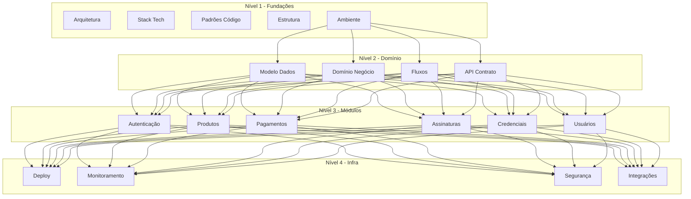

<!-- Origem: PLANO-DOCUMENTACAO-LLM.md (movido da raiz em 2026-10-20) -->

> **Este documento e o plano que orientou a organizacao da documentacao,**
> nao a especificacao do sistema. Ele foi executado: os monolitos
> `DOCUMENTACAO-SISTEMA-ECOMMERCE-DIGITAL.md` e `ESTUDO-STACK-TECNOLOGICA.md`
> foram quebrados nos documentos que ele descreve. O indice esta em
> [docs/README.md](../README.md).
>
> Consulta util: a secao "Formato de Cada Documento" define o template usado
> nos READMEs de modulo.

---

# Plano de Organização da Documentação
## Sistema E-commerce de Produtos Digitais - Implementação por LLM

---

## 1. Visão Geral do Plano

### 1.1 Objetivo

Este plano organiza toda a documentação do sistema para que uma LLM possa:
- Compreender o sistema como um todo
- Implementar cada módulo de forma independente
- Manter consistência entre módulos
- Validar a implementação contra especificações
- Escalonar a implementação em fases

### 1.2 Princípios

```
┌─────────────────────────────────────────────────────────────────┐
│                     PRINCÍPIOS DE ORGANIZAÇÃO                     │
├─────────────────────────────────────────────────────────────────┤
│                                                                  │
│  1. ORDEM DE DEPENDÊNCIA                                       │
│     ├── Fundações primeiro                                      │
│     ├── Módulos depois                                          │
│     └── Integrações por último                                  │
│                                                                  │
│  2. AUTONOMIA MODULAR                                          │
│     ├── Cada documento é autocontido                            │
│     ├── Dependências explícitas                                 │
│     └── Interfaces bem definidas                                │
│                                                                  │
│  3. EXECUTÁVEL                                                 │
│     ├── Código funcional em vez de descrições                    │
│     ├── Testes como especificação                              │
│     └── Exemplos completos                                      │
│                                                                  │
│  4. VALIDÁVEL                                                  │
│     ├── Critérios de aceite claros                             │
│     ├── Checklist de verificação                               │
│     └── Testes de unidade obrigatórios                          │
│                                                                  │
└─────────────────────────────────────────────────────────────────┘
```

---

## 2. Estrutura de Diretórios

```
docs/
├── README.md                    # Visão geral + navegação
├── PLANO.md                     # Este arquivo
│
├── FUNDACOES/
│   ├── 01-ARQUITETURA.md       # Visão sistêmica
│   ├── 02-STACK-TEC.md          # Tecnologias escolhidas
│   ├── 03-PADROES-CODIGO.md    # Convenções e estilos
│   ├── 04-ESTRUTURA-PROJETO.md  # Organização de arquivos
│   └── 05-AMBIENTE.md           # Setup de desenvolvimento
│
├── DOMINIO/
│   ├── 01-MODELO-DADOS.md       # Schema completo
│   ├── 02-DOMINIO-NEGOCIO.md   # Regras e invariantes
│   ├── 03-FLUXOS-NEGOCIO.md    # Fluxos principais
│   └── 04-API-CONTRATO.md       # Contratos REST
│
├── MODULOS/
│   ├── AUTENTICACAO/
│   │   ├── README.md
│   │   ├── SPEC.md
│   │   ├── CODIGO.md
│   │   └── TESTES.md
│   │
│   ├── PRODUTOS/
│   │   ├── README.md
│   │   ├── SPEC.md
│   │   ├── CODIGO.md
│   │   └── TESTES.md
│   │
│   ├── PAGAMENTOS/
│   │   ├── README.md
│   │   ├── SPEC.md
│   │   ├── CODIGO.md
│   │   └── TESTES.md
│   │
│   ├── ASSINATURAS/
│   │   ├── README.md
│   │   ├── SPEC.md
│   │   ├── CODIGO.md
│   │   └── TESTES.md
│   │
│   ├── CREDENCIAIS/
│   │   ├── README.md
│   │   ├── SPEC.md
│   │   ├── CODIGO.md
│   │   └── TESTES.md
│   │
│   └── USUARIOS/
│       ├── README.md
│       ├── SPEC.md
│       ├── CODIGO.md
│       └── TESTES.md
│
├── INFRAESTRUTURA/
│   ├── 01-DEPLOY.md             # Deploy em produção
│   ├── 02-MONITORAMENTO.md      # Logs e métricas
│   ├── 03-SECURITY.md          # Segurança e LGPD
│   └── 04-INTEGRACOES.md       # Serviços externos
│
├── GUIAS/
│   ├── IMPLEMENTACAO.md        # Como implementar
│   ├── VALIDACAO.md            # Como validar
│   └── DEBUG.md                # Troubleshooting
│
└── REFERENCIAS/
    ├── GLOSSARIO.md            # Termos técnicos
    ├── ABREVIACOES.md          # Siglas
    └── EXTERNAL.md             # Links úteis
```

---

## 3. Hierarquia de Documentos

### 3.1 Níveis de Documentação

```
┌─────────────────────────────────────────────────────────────────┐
│                    NÍVEIS DE DOCUMENTAÇÃO                         │
├─────────────────────────────────────────────────────────────────┤
│                                                                  │
│  NÍVEL 1: CONTEXTUAL (Fundações)                                 │
│  ═══════════════════════════════════                             │
│  • Arquitetura do sistema                                       │
│  • Stack tecnológica                                            │
│  • Padrões de código                                            │
│  • Estrutura do projeto                                         │
│                                                                  │
│  Dependência: Nenhuma                                          │
│  Lido por: Todas as implementações                              │
│                                                                  │
│  ─────────────────────────────────────────────────────────────  │
│                                                                  │
│  NÍVEL 2: ESPECIFICAÇÃO (Domínio)                               │
│  ═════════════════════════════════════                           │
│  • Modelo de dados                                              │
│  • Regras de negócio                                            │
│  • Fluxos de negócio                                            │
│  • Contratos de API                                            │
│                                                                  │
│  Dependência: Nível 1                                          │
│  Lido por: Implementação de módulos                             │
│                                                                  │
│  ─────────────────────────────────────────────────────────────  │
│                                                                  │
│  NÍVEL 3: IMPLEMENTAÇÃO (Módulos)                               │
│  ═════════════════════════════════════                           │
│  • README - Visão geral do módulo                              │
│  • SPEC - Especificação técnica                                │
│  • CÓDIGO - Código fonte documentado                           │
│  • TESTES - Casos de teste                                     │
│                                                                  │
│  Dependência: Nível 1 + Nível 2                                │
│  Lido por: Implementação específica                             │
│                                                                  │
│  ─────────────────────────────────────────────────────────────  │
│                                                                  │
│  NÍVEL 4: OPERACIONAL (Infraestrutura)                          │
│  ═══════════════════════════════════════                         │
│  • Deploy e configurações                                       │
│  • Monitoramento e alertas                                      │
│  • Segurança e compliance                                       │
│  • Integrações externas                                         │
│                                                                  │
│  Dependência: Nível 1 + Nível 2 + Nível 3                     │
│  Lido por: DevOps e operações                                  │
│                                                                  │
└─────────────────────────────────────────────────────────────────┘
```

### 3.2 Mapa de Dependências



---

## 4. Formato de Cada Documento

### 4.1 Template: README do Módulo

```markdown
# [Nome do Módulo]

## Objetivo
Breve descrição do módulo e seu propósito no sistema.

## Responsabilidades
- Lista de responsabilidades claras
- O que o módulo faz
- O que o módulo NÃO faz

## Dependências
- Módulos que este depende
- Serviços externos necessários
- Pré-requisitos

## Interfaces
### Entradas
- APIs que consome
- Eventos que escuta
- Dados que recebe

### Saídas
- APIs que expõe
- Eventos que publica
- Dados que produz

## Estados
- Estados possíveis do módulo
- Transições entre estados
- Estados iniciais e finais

## Fluxo Principal
Diagrama ou descrição do fluxo principal.

## Fluxos Alternativos
- Tratamento de erros
- Casos de borda
- edge cases

## Métricas
- KPIs do módulo
- Como medir sucesso

## Progresso
- [ ] Implementado
- [ ] Testado
- [ ] Deployado
```

### 4.2 Template: SPEC do Módulo

```markdown
# Especificação Técnica - [Nome do Módulo]

## 1. Visão Geral
Breve descrição técnica.

## 2. Interface de API

### 2.1 Endpoints

#### POST /api/modulo/recurso
**Descrição**: O que faz

**Headers**:
```
Authorization: Bearer {token}
Content-Type: application/json
```

**Request Body**:
```json
{
  "campo1": "tipo - descrição",
  "campo2": "tipo - descrição"
}
```

**Response 200**:
```json
{
  "success": true,
  "data": {
    "id": "uuid",
    "campo1": "valor"
  }
}
```

**Response 400**:
```json
{
  "success": false,
  "error": {
    "code": "VALIDATION_ERROR",
    "message": "Descrição do erro",
    "details": {}
  }
}
```

**Response 401**:
```json
{
  "success": false,
  "error": {
    "code": "UNAUTHORIZED",
    "message": "Não autorizado"
  }
}
```

### 2.2 Schemas de Validação (Zod)
```typescript
// Código do schema Zod
```

## 3. Modelo de Dados

### 3.1 Tabelas/Collections

#### tabela_nome
| Coluna | Tipo | Constraints | Descrição |
|--------|------|-------------|-----------|
| id | UUID | PK | Identificador |
| created_at | TIMESTAMP | NOT NULL | Data criação |

## 4. Regras de Negócio

### 4.1 Invariantes
- Regra 1
- Regra 2

### 4.2 Validações
- Validação 1
- Validação 2

### 4.3 Side Effects
- Efeito colateral 1
- Efeito colateral 2

## 5. Fluxo de Execução

### 5.1 Happy Path
```
1. Receber requisição
2. Validar input
3. Verificar permissões
4. Executar lógica
5. Persistir dados
6. Retornar resposta
```

### 5.2 Tratamento de Erros
```
1. Erro de validação → 400
2. Não autorizado → 401
3. Não encontrado → 404
4. Erro interno → 500
```

## 6. Segurança

### 6.1 Autenticação
- Requer autenticação: Sim/Não
- Tipo de token: JWT/Bearer

### 6.2 Autorização
- Roles necessários
- Permissões específicas

### 6.3 Validação
- Sanitização de input
- Prevenção de SQL injection
- Rate limiting

## 7. Integrações

### 7.1 Serviços Externos
| Serviço | Método | Propósito |
|---------|--------|-----------|
| Redis | GET/SET | Cache |
| Mercado Pago | POST | Pagamentos |

## 8. Testes

### 8.1 Casos de Teste

| ID | Descrição | Entrada | Saída Esperada |
|----|-----------|---------|----------------|
| TC-001 | Criar recurso válido | {...} | 201 + recurso |
| TC-002 | Criar sem autenticação | {...} | 401 |
| TC-003 | Criar com dados inválidos | {invalid} | 400 + erros |

## 9. Critérios de Aceite

- [ ] Endpoint responde com 201 ao criar
- [ ] Validação retorna 400 com campos inválidos
- [ ] Não autenticado retorna 401
- [ ] Dados persistidos no banco
- [ ] Evento publicado após criação
```

### 4.3 Template: CÓDIGO do Módulo

```markdown
# Código Fonte - [Nome do Módulo]

## Estrutura de Arquivos
```
src/modules/modulo/
├── modulo.routes.ts      # Rotas da API
├── modulo.service.ts    # Lógica de negócio
├── modulo.schema.ts     # Validação Zod
├── modulo.repository.ts  # Acesso a dados
└── tests/
    ├── modulo.service.test.ts
    └── modulo.routes.test.ts
```

## Código Completo

### modulo.routes.ts
```typescript
// Código completo e funcional
```

### modulo.service.ts
```typescript
// Código completo e funcional
```

### modulo.schema.ts
```typescript
// Código completo e funcional
```

## Instruções de Implementação

### Passo 1: Configurar Schema
1. Copiar modulo.schema.ts
2. Personalizar validações
3. Exportar tipos

### Passo 2: Implementar Repository
1. Criar operações de banco
2. Tratar erros de query
3. Adicionar logging

### Passo 3: Implementar Service
1. Implementar lógica de negócio
2. Chamar repository
3. Publicar eventos

### Passo 4: Implementar Routes
1. Definir endpoints
2. Adicionar autenticação
3. Mapear erros

## Notas de Implementação
- Pontos de atenção
- Decisões de design
- trade-offs considerados
```

### 4.4 Template: TESTES do Módulo

```markdown
# Testes - [Nome do Módulo]

## Estratégia de Testes

### Pirâmide de Testes
```
        ┌───────────┐
        │   E2E    │     10%
        ├───────────┤
        │ Integração│    30%
        ├───────────┤
        │  Unitário │    60%
        └───────────┘
```

## Testes Unitários

### modulo.service.test.ts
```typescript
// Testes unitários completos
```

### modulo.schema.test.ts
```typescript
// Testes de validação
```

## Testes de Integração

### modulo.routes.test.ts
```typescript
// Testes de API com Fastify
```

## Testes E2E

### modulo.e2e.test.ts
```typescript
// Testes de fluxo completo
```

## Cobertura Mínima
- [ ] 80% de cobertura de branches
- [ ] 100% dos endpoints testados
- [ ] 100% das regras de negócio testadas

## Dados de Teste

### Factories
```typescript
// factories para criar dados de teste
```
```

---

## 5. Ordem de Leitura para LLM

### 5.1 Sequência de Implementação

```
┌─────────────────────────────────────────────────────────────────┐
│                 ORDEM DE IMPLEMENTAÇÃO                          │
├─────────────────────────────────────────────────────────────────┤
│                                                                  │
│  FASE 1: FUNDAMENTOS (Executar primeiro)                       │
│  ═══════════════════════════════════════                        │
│  1. 📖 Ler: FUNDACOES/01-ARQUITETURA.md                        │
│  2. 📖 Ler: FUNDACOES/02-STACK-TEC.md                          │
│  3. 📖 Ler: FUNDACOES/03-PADROES-CODIGO.md                     │
│  4. 📖 Ler: FUNDACOES/04-ESTRUTURA-PROJETO.md                  │
│  5. 📖 Ler: FUNDACOES/05-AMBIENTE.md                           │
│  6. ⚙️  Configurar ambiente de desenvolvimento                  │
│                                                                  │
│  ─────────────────────────────────────────────────────────────  │
│                                                                  │
│  FASE 2: DOMÍNIO (Executar segundo)                            │
│  ═════════════════════════════════════                          │
│  1. 📖 Ler: DOMINIO/01-MODELO-DADOS.md                          │
│  2. 📖 Ler: DOMINIO/02-DOMINIO-NEGOCIO.md                      │
│  3. 📖 Ler: DOMINIO/03-FLUXOS-NEGOCIO.md                       │
│  4. 📖 Ler: DOMINIO/04-API-CONTRATO.md                         │
│  5. ⚙️  Criar migrations e seeders                             │
│                                                                  │
│  ─────────────────────────────────────────────────────────────  │
│                                                                  │
│  FASE 3: MÓDULOS CORE (Executar terceiro)                      │
│  ═════════════════════════════════════                          │
│                                                                  │
│  3.1 AUTENTICAÇÃO                                              │
│      1. 📖 Ler: MODULOS/AUTENTICACAO/READE.md                   │
│      2. 📖 Ler: MODULOS/AUTENTICACAO/SPEC.md                    │
│      3. 📖 Ler: MODULOS/AUTENTICACAO/CODIGO.md                  │
│      4. 📖 Ler: MODULOS/AUTENTICACAO/TESTES.md                  │
│      5. ⚙️  Implementar                                          │
│                                                                  │
│  3.2 USUÁRIOS                                                   │
│      1. 📖 Ler: MODULOS/USUARIOS/README.md                      │
│      2. 📖 Ler: MODULOS/USUARIOS/SPEC.md                       │
│      3. 📖 Ler: MODULOS/USUARIOS/CODIGO.md                      │
│      4. 📖 Ler: MODULOS/USUARIOS/TESTES.md                     │
│      5. ⚙️  Implementar                                          │
│                                                                  │
│  3.3 PRODUTOS                                                  │
│      1. 📖 Ler: MODULOS/PRODUTOS/README.md                      │
│      2. 📖 Ler: MODULOS/PRODUTOS/SPEC.md                       │
│      3. 📖 Ler: MODULOS/PRODUTOS/CODIGO.md                      │
│      4. 📖 Ler: MODULOS/PRODUTOS/TESTES.md                     │
│      5. ⚙️  Implementar                                          │
│                                                                  │
│  ─────────────────────────────────────────────────────────────  │
│                                                                  │
│  FASE 4: MÓDULOS DE NEGÓCIO (Executar quarto)                   │
│  ══════════════════════════════════════════                     │
│                                                                  │
│  4.1 PAGAMENTOS                                                │
│      1. 📖 Ler: MODULOS/PAGAMENTOS/README.md                    │
│      2. 📖 Ler: MODULOS/PAGAMENTOS/SPEC.md                     │
│      3. 📖 Ler: MODULOS/PAGAMENTOS/CODIGO.md                   │
│      4. 📖 Ler: MODULOS/PAGAMENTOS/TESTES.md                   │
│      5. ⚙️  Implementar                                          │
│                                                                  │
│  4.2 ASSINATURAS                                               │
│      1. 📖 Ler: MODULOS/ASSINATURAS/README.md                  │
│      2. 📖 Ler: MODULOS/ASSINATURAS/SPEC.md                   │
│      3. 📖 Ler: MODULOS/ASSINATURAS/CODIGO.md                  │
│      4. 📖 Ler: MODULOS/ASSINATURAS/TESTES.md                 │
│      5. ⚙️  Implementar                                          │
│                                                                  │
│  4.3 CREDENCIAIS                                               │
│      1. 📖 Ler: MODULOS/CREDENCIAIS/README.md                  │
│      2. 📖 Ler: MODULOS/CREDENCIAIS/SPEC.md                   │
│      3. 📖 Ler: MODULOS/CREDENCIAIS/CODIGO.md                  │
│      4. 📖 Ler: MODULOS/CREDENCIAIS/TESTES.md                 │
│      5. ⚙️  Implementar                                          │
│                                                                  │
│  ─────────────────────────────────────────────────────────────  │
│                                                                  │
│  FASE 5: INTEGRAÇÕES (Executar quinto)                          │
│  ═══════════════════════════════════                            │
│  1. 📖 Ler: INFRAESTRUTURA/04-INTEGRACOES.md                   │
│  2. ⚙️  Configurar webhooks                                    │
│  3. ⚙️  Configurar filas                                       │
│  4. ⚙️  Configurar e-mail                                      │
│                                                                  │
│  ─────────────────────────────────────────────────────────────  │
│                                                                  │
│  FASE 6: INFRAESTRUTURA (Executar sexto)                        │
│  ═════════════════════════════════════                          │
│  1. 📖 Ler: INFRAESTRUTURA/01-DEPLOY.md                        │
│  2. 📖 Ler: INFRAESTRUTURA/02-MONITORAMENTO.md                │
│  3. 📖 Ler: INFRAESTRUTURA/03-SECURITY.md                     │
│  4. ⚙️  Deploy em produção                                      │
│                                                                  │
└─────────────────────────────────────────────────────────────────┘
```

---

## 6. Critérios de Validação

### 6.1 Checklist por Fase

```markdown
## FASE 1: Fundações ✅/❌

- [ ] Repositório criado com estrutura correta
- [ ] Node.js 20.x instalado
- [ ] TypeScript configurado
- [ ] ESLint + Prettier configurados
- [ ] Husky + lint-staged configurados
- [ ] Docker + Docker Compose instalados
- [ ] PostgreSQL acessível via Docker
- [ ] Redis acessível via Docker
- [ ] Variables de ambiente configuradas
- [ ] git initialized e primeiro commit feito

## FASE 2: Domínio ✅/❌

- [ ] Schema Prisma criado
- [ ] Migration inicial executada
- [ ] Seeders de desenvolvimento criados
- [ ] Types do Prisma gerados
- [ ] Enums e tipos compartilhados definidos
- [ ] Contratos de API documentados

## FASE 3: Módulos Core ✅/❌

Para cada módulo:
- [ ] Módulo criado com estrutura padrão
- [ ] Rotas registradas no app
- [ ] Service implementado
- [ ] Repository implementado
- [ ] Schema de validação implementado
- [ ] Middleware de autenticação (se aplicável)
- [ ] Testes unitários passando
- [ ] Testes de integração passando
- [ ] Cobertura > 80%

## FASE 4: Integrações ✅/❌

- [ ] Mercado Pago configurado
- [ ] Webhooks funcionando
- [ ] Fila de jobs configurada
- [ ] E-mail service configurado
- [ ] Storage configurado

## FASE 5: Produção ✅/❌

- [ ] Frontend deployado na Vercel
- [ ] API deployada no Fly.io
- [ ] Database migrado
- [ ] Health checks respondendo
- [ ] Logs centralizados
- [ ] Métricas exportadas
- [ ] Alertas configurados
```

### 6.2 Checklist de Qualidade de Código

```markdown
## Código ✅/❌

- [ ] Sem erros de TypeScript
- [ ] Sem warnings do ESLint
- [ ] Nomes significativos (camelCase para vars, PascalCase para types)
- [ ] Funções pequenas (< 50 linhas)
- [ ] DRY - Sem repetição de código
- [ ] Comments explicando decisões, não código
- [ ] Error handling em todos os níveis

## Testes ✅/❌

- [ ] Testes unitários para services
- [ ] Testes de integração para rotas
- [ ] Mocks para serviços externos
- [ ]Fixtures/ factories para dados de teste
- [ ] Cobertura de branches > 80%
- [ ] Testes com nomes descritivos

## Segurança ✅/❌

- [ ] Input validado com Zod
- [ ] SQL injection-prevenido (Prisma parameterized)
- [ ] XSS-prevenido (escape de output)
- [ ] CSRF tokens em forms
- [ ] Rate limiting configurado
- [ ] Headers de segurança (Helmet)
- [ ] Secrets em env, não em código
```

---

## 7. Padrões e Convenções

### 7.1 Nomeação

```
┌─────────────────────────────────────────────────────────────────┐
│                        PADRÕES DE NOMEAÇÃO                       │
├─────────────────────────────────────────────────────────────────┤
│                                                                  │
│  ARQUIVOS                                                       │
│  ───────                                                        │
│  Componentes React:     PascalCase (UserCard.tsx)              │
│  Services/Utils:        camelCase (userService.ts)             │
│  Schemas:               camelCase (userSchema.ts)                │
│  Testes:                nome.test.ts ou nome.spec.ts           │
│  Migrations:            kebab-case (add-user-table.ts)          │
│                                                                  │
│  FUNÇÕES/MÉTODOS                                                │
│  ─────────────────                                               │
│  Verbos:                create, update, delete, get, list      │
│  Formato:               camelCase                              │
│  Exemplos:              createUser, getProductById, listOrders │
│                                                                  │
│  VARIÁVEIS                                                      │
│  ─────────                                                       │
│  Formato:               camelCase                              │
│  Booleanos:             is, has, can, should (isActive)        │
│  Arrays:                plural ou sufixo List (users, orderList)│
│  Constantes:            UPPER_SNAKE_CASE (MAX_RETRY)           │
│                                                                  │
│  TIPOS/INTERFACES                                                │
│  ─────────────────                                               │
│  Formato:               PascalCase                             │
│  Interfaces:            ISubstantivo (IUser, IOrder)            │
│  Types:                 Tipo + Sufixo (UserDTO, OrderResponse)   │
│  Enums:                 PascalCase com valores UPPER_SNAKE      │
│                                                                  │
│  TABELAS/COLUNAS (PostgreSQL)                                   │
│  ─────────────────────────                                      │
│  Tabelas:              snake_case plural (user_accounts)        │
│  Colunas:              snake_case (created_at, user_id)         │
│  PK:                   id ou nome_tabela_id                     │
│  FK:                   nome_tabela_id                          │
│  Index:                idx_nome_tabela_coluna                   │
│                                                                  │
│  API ENDPOINTS                                                   │
│  ────────────                                                    │
│  Formato:             kebab-case (user-accounts)               │
│  Verbo HTTP:           GET (leitura), POST (criar),            │
│                        PUT/PATCH (atualizar), DELETE (remover) │
│  Exemplos:             GET /user-accounts, POST /orders         │
│                                                                  │
│  DIRETÓRIOS                                                      │
│  ──────────                                                      │
│  Formato:             kebab-case (user-accounts)               │
│  Módulos:             plural (users, orders, products)         │
│                                                                  │
└─────────────────────────────────────────────────────────────────┘
```

### 7.2 Estrutura de Módulo

```
modules/
└── [nome-do-modulo]/
    ├── [nome].routes.ts       # Rotas Fastify
    ├── [nome].service.ts      # Lógica de negócio
    ├── [nome].repository.ts   # Acesso a dados
    ├── [nome].schema.ts       # Validação Zod
    ├── [nome].types.ts        # Tipos específicos
    ├── [nome].errors.ts      # Erros customizados
    ├── [nome].constants.ts    # Constantes do módulo
    └── tests/
        ├── [nome].service.test.ts
        ├── [nome].repository.test.ts
        └── [nome].routes.test.ts
```

### 7.3 Padrão de Resposta de API

```typescript
// Sucesso
interface ApiResponse<T> {
  success: true;
  data: T;
  meta?: {
    page?: number;
    limit?: number;
    total?: number;
    [key: string]: any;
  };
}

// Erro
interface ApiError {
  success: false;
  error: {
    code: string;        // MAIUSCULO_COM_UNDERSCORE
    message: string;    // Mensagem amigável
    details?: {         // Opcional
      [field: string]: string[];
    };
  };
}

// Código de erros
const ErrorCodes = {
  VALIDATION_ERROR: 'VALIDATION_ERROR',
  UNAUTHORIZED: 'UNAUTHORIZED',
  FORBIDDEN: 'FORBIDDEN',
  NOT_FOUND: 'NOT_FOUND',
  CONFLICT: 'CONFLICT',
  INTERNAL_ERROR: 'INTERNAL_ERROR',
  SERVICE_UNAVAILABLE: 'SERVICE_UNAVAILABLE',
} as const;
```

---

## 8. Scripts de Automação

### 8.1 Script: Gerar Módulo

```bash
#!/bin/bash
# scripts/generate-module.sh

MODULE_NAME=$1
MODULE_PATH="apps/api/src/modules/$MODULE_NAME"

# Criar estrutura
mkdir -p "$MODULE_PATH/tests"

# Criar arquivos a partir de templates
cat > "$MODULE_PATH/$MODULE_NAME.routes.ts" << EOF
// TODO: Implementar rotas
EOF

cat > "$MODULE_PATH/$MODULE_NAME.service.ts" << EOF
// TODO: Implementar service
EOF

cat > "$MODULE_PATH/$MODULE_NAME.repository.ts" << EOF
// TODO: Implementar repository
EOF

cat > "$MODULE_PATH/$MODULE_NAME.schema.ts" << EOF
// TODO: Implementar schema
EOF

cat > "$MODULE_PATH/tests/$MODULE_NAME.service.test.ts" << EOF
// TODO: Implementar testes
EOF

echo "Módulo $MODULE_NAME criado em $MODULE_PATH"
```

### 8.2 Script: Validar Implementação

```bash
#!/bin/bash
# scripts/validate-implementation.sh

echo "=== Validando Implementação ==="

# TypeScript
echo "1. Verificando TypeScript..."
npx tsc --noEmit
if [ $? -ne 0 ]; then
  echo "❌ TypeScript com erros"
  exit 1
fi
echo "✅ TypeScript OK"

# ESLint
echo "2. Verificando ESLint..."
npx eslint apps/api/src --ext .ts
if [ $? -ne 0 ]; then
  echo "❌ ESLint com warnings"
  exit 1
fi
echo "✅ ESLint OK"

# Testes
echo "3. Executando testes..."
npm run test --if-present
if [ $? -ne 0 ]; then
  echo "❌ Testes falhando"
  exit 1
fi
echo "✅ Testes OK"

# Build
echo "4. Verificando build..."
npm run build
if [ $? -ne 0 ]; then
  echo "❌ Build falhou"
  exit 1
fi
echo "✅ Build OK"

echo ""
echo "=== Validação Completa ✅ ==="
```

### 8.3 Script: Novo Módulo Checklist

```markdown
# Checklist de Novo Módulo

## Ao criar novo módulo, verificar:

### Estrutura de Arquivos
- [ ] Pasta criada em `modules/`
- [ ] Arquivos seguindo padrão: routes, service, repository, schema
- [ ] Testes criados

### Código
- [ ] Types exportados
- [ ] Schema Zod definido
- [ ] Repository implementa CRUD completo
- [ ] Service com lógica de negócio
- [ ] Routes registradas no app

### Testes
- [ ] Testes unitários do service
- [ ] Testes do repository com mocks
- [ ] Testes de integração das routes
- [ ] Cobertura > 80%

### Documentação
- [ ] README.md criado
- [ ] SPEC.md criado
- [ ] CÓDIGO.md criado
- [ ] TESTES.md criado

### Integração
- [ ] Módulo importado no app
- [ ] Rotas testadas no Postman
- [ ] Health check se aplicável
```

---

## 9. Templates de Documentação

### 9.1 README Principal

```markdown
# Sistema E-commerce de Produtos Digitais

## Visão Geral
Plataforma e-commerce para venda de produtos digitais com assinatura e entrega automatizada de credenciais.

## Stack
- **Frontend**: Next.js 14, TypeScript, TailwindCSS
- **Backend**: Fastify, Node.js 20, Prisma
- **Database**: PostgreSQL, Redis
- **Payments**: Mercado Pago
- **Email**: Resend

## Começando

### Pré-requisitos
- Node.js 20+
- Docker + Docker Compose
- pnpm

### Instalação
\`\`\`bash
# Clonar repositório
git clone <repo>

# Instalar dependências
pnpm install

# Configurar ambiente
cp .env.example .env

# Subir serviços
docker-compose up -d

# Rodar migrations
pnpm db:migrate

# Seedar dados
pnpm db:seed

# Iniciar desenvolvimento
pnpm dev
\`\`\`

## Estrutura
\`\`\`
apps/
├── web/          # Frontend Next.js
└── api/          # Backend Fastify
packages/
├── ui/           # Componentes compartilhados
└── tsconfig/     # Configurações TS
\`\`\`

## Documentação
- [Arquitetura](../FUNDACOES/01-ARQUITETURA.md)
- [Stack Tecnológica](../FUNDACOES/02-STACK-TEC.md)
- [Modelo de Dados](../DOMINIO/01-MODELO-DADOS.md)
- [API](../DOMINIO/04-API-CONTRATO.md)

## Módulos
- [Autenticação](../MODULOS/AUTENTICACAO/README.md)
- [Produtos](../MODULOS/PRODUTOS/README.md)
- [Pagamentos](../MODULOS/PAGAMENTOS/README.md)
- [Assinaturas](../MODULOS/ASSINATURAS/README.md)
- [Credenciais](../MODULOS/CREDENCIAIS/README.md)

## Deploy
Ver [Guia de Deploy](../INFRAESTRUTURA/01-DEPLOY.md)

## Licença
MIT
```

---

## 10. Processos de LLM

### 10.1 Fluxo de Implementação

```
┌─────────────────────────────────────────────────────────────────┐
│              FLUXO DE IMPLEMENTAÇÃO POR LLM                      │
├─────────────────────────────────────────────────────────────────┤
│                                                                  │
│  1. 📖 LEITURA PREPARATÓRIA                                     │
│     ├── Ler ARCHITETURA.md para contexto                        │
│     ├── Ler STACK-TEC.md para tecnologias                       │
│     ├── Ler PADROES-CODIGO.md para convenções                   │
│     └── Criar mental model do sistema                           │
│                                                                  │
│  2. 📖 LEITURA DO DOMÍNIO                                       │
│     ├── Ler MODELO-DADOS.md para entidades                     │
│     ├── Ler DOMINIO-NEGOCIO.md para regras                      │
│     ├── Ler FLUXOS-NEGOCIO.md para processos                    │
│     └── Mapear dependências                                      │
│                                                                  │
│  3. 📖 LEITURA DO MÓDULO                                        │
│     ├── Ler README.md para visão geral                          │
│     ├── Ler SPEC.md para detalhes técnicos                      │
│     ├── Consultar CÓDIGO.md para padrões                       │
│     └── Verificar TESTES.md para casos                          │
│                                                                  │
│  4. ⚙️  IMPLEMENTAÇÃO                                           │
│     ├── Criar/generar arquivos                                  │
│     ├── Implementar funcionalidades                              │
│     ├── Adicionar tratamento de erros                           │
│     └── Seguir padrões documentados                             │
│                                                                  │
│  5. ✅ VALIDAÇÃO                                                │
│     ├── Rodar linter (ESLint)                                  │
│     ├── Verificar TypeScript                                    │
│     ├── Executar testes unitários                               │
│     └── Verificar cobertura                                     │
│                                                                  │
│  6. 📝 DOCUMENTAÇÃO                                             │
│     ├── Atualizar SPEC.md com decisões                          │
│     ├── Documentar edge cases                                   │
│     └── Adicionar exemplos de uso                               │
│                                                                  │
└─────────────────────────────────────────────────────────────────┘
```

### 10.2 Perguntas de Verificação

Antes de finalizar cada módulo, a LLM deve responder:

```markdown
## Verificação de Implementação

### Contexto
- [ ] Li toda a documentação relevante do módulo?
- [ ] Entendi as dependências e interfaces?
- [ ] Mapiei todos os fluxos (happy path + alternativos)?

### Código
- [ ] O código compila sem erros?
- [ ] Segui os padrões de nomenclatura?
- [ ] Tratei todos os erros possíveis?
- [ ] Adicionei logging apropriado?
- [ ] Validei inputs com Zod?

### Testes
- [ ] Testei o happy path?
- [ ] Testei casos de erro?
- [ ] Testei edge cases?
- [ ] A cobertura está > 80%?

### Integração
- [ ] O módulo conecta com dependências?
- [ ] APIs externas mockadas nos testes?
- [ ] Eventos/side effects implementados?

### Documentação
- [ ] O README está atualizado?
- [ ] Decisões de design documentadas?
- [ ] Exemplos de uso incluídos?
```

### 10.3 Critérios para Perguntar ao Humano

A LLM deve perguntar quando:

```
┌─────────────────────────────────────────────────────────────────┐
│            CRITÉRIOS PARA ESCALAR AO HUMANO                      │
├─────────────────────────────────────────────────────────────────┤
│                                                                  │
│  ⚠️  AMBIGUIDADE                                               │
│     • Requisito pode ter múltiplas interpretações               │
│     • Conflito entre especificações                             │
│     • Informação crucial faltando                               │
│                                                                  │
│  ⚠️  DECISÃO DE DESIGN COMPLEXA                                │
│     • trade-off significativo                                   │
│     • Impacto em outros módulos                                 │
│     • Reversão difícil                                          │
│                                                                  │
│  ⚠️  ERRO PERSISTENTE                                          │
│     • Bug que não consegue resolver após 2 tentativas          │
│     • Comportamento inesperado de biblioteca                   │
│     • Inconsistência entre docs e código                       │
│                                                                  │
│  ⚠️  RISCO DE NEGÓCIO                                          │
│     • Mudança que afeta fluxo de dinheiro                      │
│     • Quebra de segurança potencial                            │
│     • Impacto em compliance/LGPD                               │
│                                                                  │
│  ✅ QUANDO NÃO PRECISA PERGUNTAR                               │
│     • Dúvidas sobre sintaxe (resolver pesquisando)            │
│     • Decisões claramente definidas nos docs                  │
│     • Escolhas triviais (nomes de variáveis, etc)             │
│     • Problemas técnicos resolvidos com debugging              │
│                                                                  │
└─────────────────────────────────────────────────────────────────┘
```

---

## 11. Roadmap de Documentação

### 11.1 Criar Documentação

```
Semana 1:
├── FUNDACOES/ (5 docs)
│   ├── 01-ARQUITETURA.md
│   ├── 02-STACK-TEC.md
│   ├── 03-PADROES-CODIGO.md
│   ├── 04-ESTRUTURA-PROJETO.md
│   └── 05-AMBIENTE.md
│
├── DOMINIO/ (4 docs)
│   ├── 01-MODELO-DADOS.md
│   ├── 02-DOMINIO-NEGOCIO.md
│   ├── 03-FLUXOS-NEGOCIO.md
│   └── 04-API-CONTRATO.md
│
└── README.md principal

Semana 2:
├── MODULOS/AUTENTICACAO/
│   ├── README.md
│   ├── SPEC.md
│   ├── CODIGO.md
│   └── TESTES.md
│
├── MODULOS/USUARIOS/
│   ├── README.md
│   ├── SPEC.md
│   ├── CODIGO.md
│   └── TESTES.md
│
└── MODULOS/PRODUTOS/
    ├── README.md
    ├── SPEC.md
    ├── CODIGO.md
    └── TESTES.md

Semana 3:
├── MODULOS/PAGAMENTOS/
├── MODULOS/ASSINATURAS/
└── MODULOS/CREDENCIAIS/

Semana 4:
├── INFRAESTRUTURA/
│   ├── 01-DEPLOY.md
│   ├── 02-MONITORAMENTO.md
│   ├── 03-SECURITY.md
│   └── 04-INTEGRACOES.md
│
└── GUIAS/
    ├── IMPLEMENTACAO.md
    ├── VALIDACAO.md
    └── DEBUG.md
```

### 11.2 Total de Documentos

| Categoria | Quantidade | Linhas Estimadas |
|-----------|------------|------------------|
| Fundações | 5 | ~500 |
| Domínio | 4 | ~800 |
| Módulos (6 × 4) | 24 | ~6,000 |
| Infraestrutura | 4 | ~800 |
| Guias | 3 | ~400 |
| **Total** | **40** | **~8,500** |

---

## 12. Checklist Final

```markdown
# Plano de Documentação - Checklist

## Estrutura
- [x] Estrutura de diretórios definida
- [x] Templates criados
- [x] Convenções documentadas
- [x] Ordem de leitura estabelecida

## Fundamentos
- [ ] 01-ARQUITETURA.md
- [ ] 02-STACK-TEC.md
- [ ] 03-PADROES-CODIGO.md
- [ ] 04-ESTRUTURA-PROJETO.md
- [ ] 05-AMBIENTE.md

## Domínio
- [ ] 01-MODELO-DADOS.md
- [ ] 02-DOMINIO-NEGOCIO.md
- [ ] 03-FLUXOS-NEGOCIO.md
- [ ] 04-API-CONTRATO.md

## Módulos
- [ ] AUTENTICACAO (4 docs)
- [ ] USUARIOS (4 docs)
- [ ] PRODUTOS (4 docs)
- [ ] PAGAMENTOS (4 docs)
- [ ] ASSINATURAS (4 docs)
- [ ] CREDENCIAIS (4 docs)

## Infraestrutura
- [ ] 01-DEPLOY.md
- [ ] 02-MONITORAMENTO.md
- [ ] 03-SECURITY.md
- [ ] 04-INTEGRACOES.md

## Guias
- [ ] IMPLEMENTACAO.md
- [ ] VALIDACAO.md
- [ ] DEBUG.md

## Referências
- [ ] GLOSSARIO.md
- [ ] ABREVIACOES.md
- [ ] EXTERNAL.md

## README
- [ ] README.md principal
- [ ] Navegação entre docs
- [ ] Badges e status
```

---

*Documento criado em: 2024*
*Versão: 1.0*
*Objetivo: Guiar implementação por LLM*
